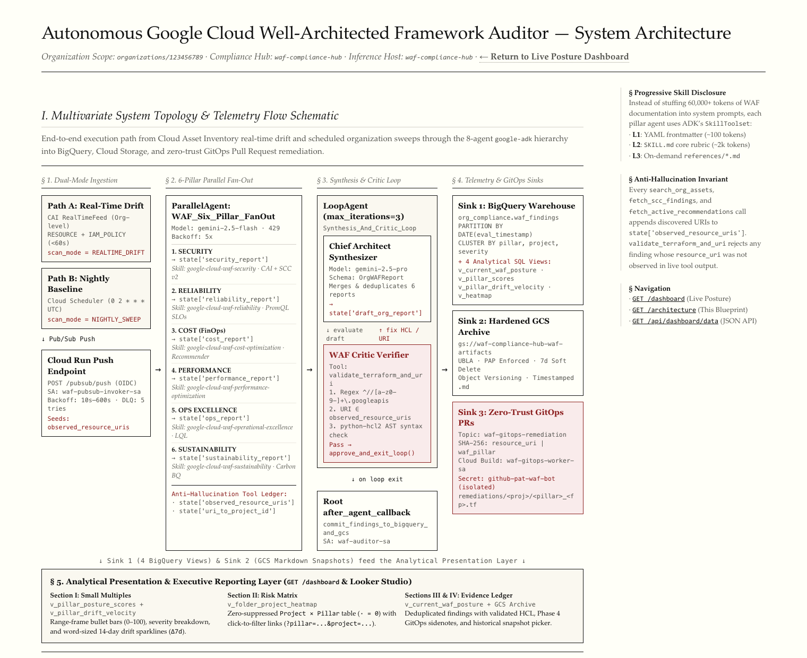
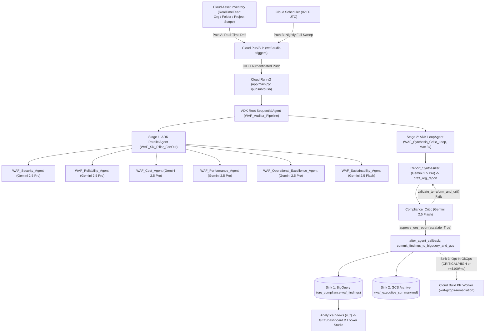
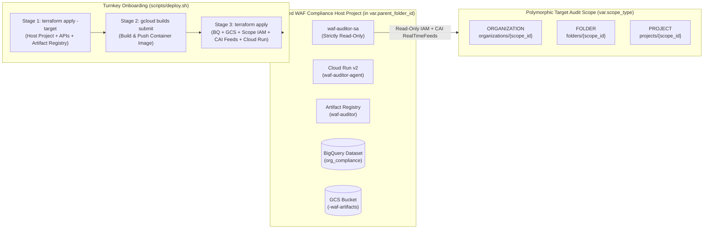
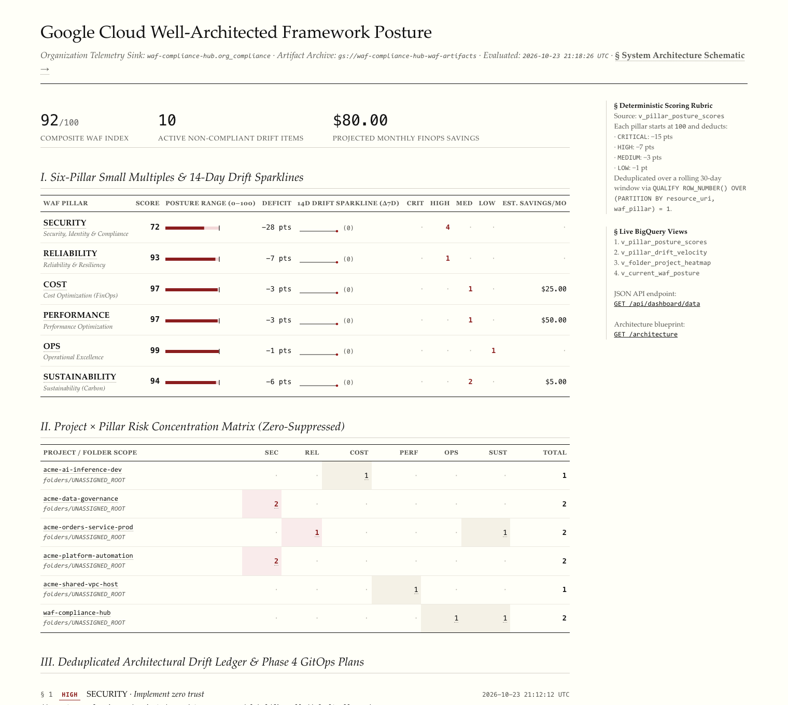
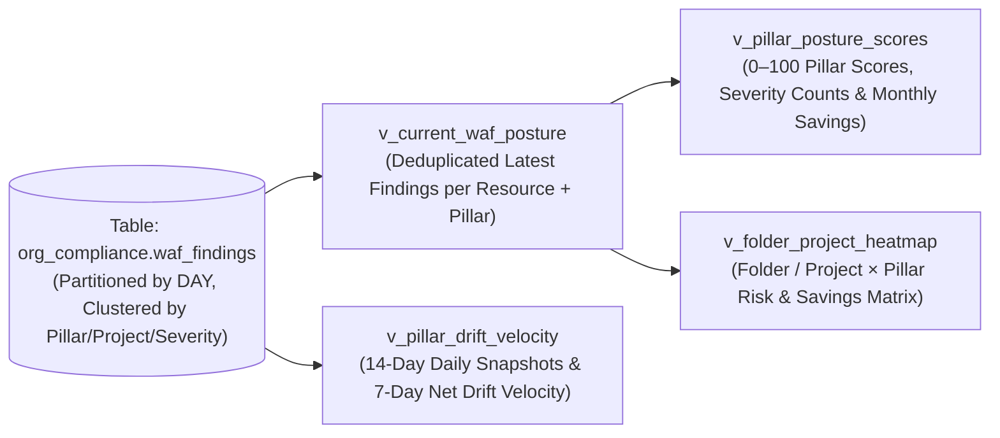

# Autonomous Google Cloud Well-Architected Framework (WAF) Auditor

An event-driven and scheduled multi-agent system built with the **Google Agent Development Kit (ADK)** (`google-adk`) and grounded in Google's official `google-cloud-waf-*` agent skills.

Instead of relying on an LLM to parse raw JSON dumps of thousands of cloud resources, this architecture separates **deterministic telemetry gathering** (Cloud Asset Inventory, Security Command Center v2, Active Assist Recommender, Carbon Footprint BigQuery Exports) from **agentic architectural reasoning** across all six pillars of the Google Cloud Well-Architected Framework.

---

## Architecture Overview

### 1. Multivariate System Topology & Telemetry Flow (`GET /architecture`)





### 2. Multi-Organization / Folder / Project Deployment Topology

By default (`create_compliance_project = true`), Terraform provisions a dedicated **WAF Compliance Host Project** inside a folder you specify (`parent_folder_id`) and attaches scope-matched read-only IAM roles and Cloud Asset Inventory `RealTimeFeed`s at the **Organization**, **Folder**, or **Project** level:



---

## Sample Analytical Dashboards

### 1. Built-In Edward Tufte Analytical Posture Dashboard (`GET /dashboard`)

The Cloud Run service includes a built-in, zero-dependency analytical web dashboard at `GET /dashboard` (with raw JSON telemetry at `GET /api/dashboard/data` and the system schematic at `GET /architecture`) designed around Edward R. Tufte's principles of high data-ink ratio, booktabs typography, word-sized 14-day SVG drift sparklines, and zero-suppressed risk concentration matrices:



Key interactive sections on `GET /dashboard`:
- **Horizon Summary Strip:** Displays the composite WAF Index (`0–100`), active non-compliant drift count, and projected monthly FinOps savings (`$/mo`).
- **Section I — Six-Pillar Small Multiples & 14-Day Drift Sparklines (`v_pillar_posture_scores` + `v_pillar_drift_velocity`):** Horizontal bullet micro-bars showing each pillar's score, point deficit, inline 14-day SVG sparkline (`Δ7d` net drift), severity breakdown, and monthly savings opportunity. Clicking any pillar row cross-filters the drift ledger.
- **Section II — Project × Pillar Risk Concentration Matrix (`v_folder_project_heatmap`):** Zero-suppressed matrix where zero-risk cells render as quiet middle dots (`·`) so high-risk project/pillar intersections stand out immediately. Clicking any cell or project filters Section III.
- **Section III — Deduplicated Architectural Drift Ledger & Phase 4 GitOps Plans (`v_current_waf_posture`):** Lists each active finding with its canonical Cloud Asset Inventory URI, architectural rationale, Critic-validated copy-paste Terraform HCL remediation block, and Phase 4 GitOps PR sidenote (`fingerprint`, target branch, and `.tf` file path).

### 2. Looker Studio Executive Dashboard & Analytical BigQuery Views (`org_compliance.v_*`)

In addition to `GET /dashboard`, Terraform provisions four analytical SQL views in BigQuery (`terraform/bigquery.tf`) to power Looker Studio or BI dashboards:



| Dashboard Row | Chart Type | BigQuery Source View | Dimension / Metric Mapping |
| :--- | :--- | :--- | :--- |
| **Row 1: Executive Header & Pillar Scorecards** | 6x **Bullet / Gauge Charts** + 1x **Savings Scorecard** | `v_pillar_posture_scores` | Metric: `pillar_score_0_to_100` (`0–100`) per `waf_pillar`; Savings KPI: `SUM(potential_monthly_savings_usd)`. |
| **Row 2: 7-Day Drift Velocity** | **Time-Series Combo Chart** (Stacked Bars + Line) | `v_pillar_drift_velocity` | X-Axis: `audit_date`; Stacked Bars: `high_risk_count` by `waf_pillar`; Line: `seven_day_drift_velocity`. |
| **Row 3: Organizational Risk Heatmap** | **Pivot Table with Heatmap** | `v_folder_project_heatmap` | Rows: `folder_id`, `project_id`; Columns: `waf_pillar`; Metric: `critical_findings + high_findings`. |
| **Row 4: Terraform Remediation Workbench** | **Expandable Data Table** | `v_current_waf_posture` | Columns: `severity`, `project_id`, `waf_pillar`, `waf_principle`, `resource_uri`, `rationale`, `terraform_remediation`, `estimated_monthly_savings_usd`. |

---

## Repository Structure

```text
├── Dockerfile                          # Non-root Python 3.12 container with uv, ADK, and vendored skills
├── pyproject.toml                      # Dependencies: google-adk, python-frontmatter, python-hcl2, google-cloud-*
├── cloudbuild.yaml                     # Shift-Left CI/CD: pytest + terraform validate + Docker build + Cloud Run deploy
├── docs/assets/                        # Sample Tufte dashboard & architecture schematic screenshots
├── agent/skills/                       # Vendored Google Cloud skills (including all 6 google-cloud-waf-* pillars)
├── app/
│   ├── __init__.py                     # Exports root_agent for ADK CLI & FastAPI Runner
│   ├── main.py                         # FastAPI /pubsub/push, /dashboard, & /architecture endpoints
│   ├── agent.py                        # ParallelAgent (6 pillars), LoopAgent (Synthesizer + Critic), and root_agent
│   ├── config.py                       # Centralized WAFConfig & dynamic multi-org/folder/project scope normalization
│   ├── dashboard.py                    # Tufte-inspired Compliance Dashboard & Architecture UI renderer
│   ├── gitops.py                       # Optional GitOps remediation branch & PR publisher
│   ├── skill_loader.py                 # WAFSkillLoader & progressive disclosure grounding reader
│   ├── gcp_tools.py                    # Deterministic CAI, SCC v2, Recommender, BQ & HCL AST validator tools
│   └── schemas.py                      # Pydantic models (WAFFinding, PillarEvaluationReport, OrganizationWAFReport)
├── scripts/
│   ├── deploy.sh                       # Turnkey 3-stage deployment script (Bootstrap -> Build -> Converge)
│   ├── gitops_pr_generator.py          # Phase 4 GitOps Pull Request planner CLI
│   └── replay_drift.py                 # CLI utility to replay synthetic CAI drift fixtures or nightly sweeps locally
├── tests/
│   ├── fixtures/cai_drift_samples.json # Synthetic CAI TemporalAsset payloads (open SSH firewall, zonal Cloud SQL)
│   ├── eval/                           # ADK evaluation dataset (`waf_auditor.evalset.json` & `test_config.json`)
│   ├── test_critic_validation.py       # Unit tests for URI hallucination, HCL AST & skill loading
│   ├── test_critic_loop.py             # Integration test for LoopAgent self-correction & early exit
│   ├── test_gitops_pr.py               # Unit tests for GitOps fingerprinting & durable GCS dispatch ledger
│   ├── test_multi_org_portability.py   # Unit tests for scope normalization, config defaults, and deploy.sh CLI
│   └── test_pubsub_push.py             # FastAPI /pubsub/push & /dashboard integration tests
└── terraform/
    ├── versions.tf                     # Terraform >= 1.5, Google ~> 6.0 & Random ~> 3.6 provider constraints
    ├── project.tf                      # Dedicated WAF Compliance Host Project bootstrap (default) & scope resolution
    ├── services.tf                     # Required Google Cloud APIs & Artifact Registry repository
    ├── iam.tf                          # Scope-aware read-only Service Account (Org/Folder/Project) & host least-privilege IAM
    ├── pubsub_cai.tf                   # Cloud Asset Inventory RealTimeFeeds (Organization, Folder, or Project scope)
    ├── bigquery.tf                     # Partitioned waf_findings table & 4 Looker Studio analytical views
    ├── cloud_run.tf                    # Cloud Run v2 service, OIDC push subscription & Nightly Cloud Scheduler job
    ├── gitops_cloudbuild.tf            # Opt-in Phase 4 GitOps Cloud Build trigger & Secret Manager isolation
    ├── outputs.tf                      # Exported compliance_project_id, canonical_scope, cloud_run_service_uri, etc.
    └── terraform.tfvars.example        # Documented presets for Org, Folder, or existing Project deployments
```

---

## Local Development & Verification

### 1. Run Unit & Async Integration Tests (34 Tests)
```bash
uv run --extra dev pytest -v -k "not asyncio"
uv run --extra dev pytest tests/test_pubsub_push.py tests/test_critic_loop.py -v -k "asyncio"
```

### 2. Replay Synthetic Cloud Asset Inventory Drift Events Locally
Start the FastAPI Pub/Sub push server in one terminal (and open `http://127.0.0.1:8080/dashboard` or `http://127.0.0.1:8080/architecture` in your browser):
```bash
export GOOGLE_CLOUD_PROJECT="waf-compliance-hub"
export GOOGLE_CLOUD_LOCATION="us-central1"
export GOOGLE_GENAI_USE_VERTEXAI="TRUE"
uv run uvicorn app.main:app --reload --port 8080
```

In a second terminal, use `scripts/replay_drift.py` to inspect or send synthetic drift events:
```bash
# List available synthetic CAI drift fixtures
uv run python scripts/replay_drift.py --list

# Preview the base64-encoded Pub/Sub push envelope without sending
uv run python scripts/replay_drift.py --fixture open_ssh_firewall --dry-run

# Replay a real-time firewall drift event against local server
uv run python scripts/replay_drift.py --fixture open_ssh_firewall

# Trigger a full nightly baseline sweep
uv run python scripts/replay_drift.py --mode NIGHTLY_SWEEP --org-id organizations/123456789
```

### 3. Launch Interactive ADK Web UI
```bash
gcloud auth application-default login --project=waf-compliance-hub
uv run adk web
```

### 4. Run ADK Trajectory & Rubric Evaluation
```bash
uv run adk eval app tests/eval/waf_auditor.evalset.json --config_file_path=tests/eval/test_config.json
```

---

## Environment Variables

| Variable | Default | Description |
| :--- | :--- | :--- |
| `GOOGLE_CLOUD_PROJECT` | `waf-compliance-hub` | Compliance host project ID for Vertex AI, BigQuery, and Cloud Run |
| `GOOGLE_CLOUD_QUOTA_PROJECT` | `<GOOGLE_CLOUD_PROJECT>` | Explicit quota project ID attached to GCP SDK clients |
| `GOOGLE_CLOUD_LOCATION` | `us-central1` | Region for Vertex AI Gemini models and Cloud Run |
| `GOOGLE_GENAI_USE_VERTEXAI` | `TRUE` | Routes ADK `LlmAgent` calls through Vertex AI |
| `WAF_TARGET_SCOPE` | `projects/<GOOGLE_CLOUD_PROJECT>` | Canonical audit scope (`organizations/<id>`, `folders/<id>`, or `projects/<id>`) |
| `WAF_ORG_ID` | *(Legacy alias for `WAF_TARGET_SCOPE`)* | Backward-compatible fallback for `WAF_TARGET_SCOPE` |
| `WAF_BQ_TABLE` | `<GOOGLE_CLOUD_PROJECT>.org_compliance.waf_findings` | Destination BigQuery table for validated findings |
| `WAF_GCS_BUCKET` | `<GOOGLE_CLOUD_PROJECT>-waf-artifacts` | GCS bucket for `waf_executive_summary.md` artifacts |
| `WAF_CARBON_EXPORT_TABLE` | `""` | Optional Carbon Footprint BigQuery export table (`project.dataset.table`); degrades gracefully when unconfigured |
| `WAF_RECOMMENDER_LOCATIONS` | `global,<GOOGLE_CLOUD_LOCATION>,us-east1,europe-west1,asia-east1` | Comma-separated baseline locations for Active Assist Recommender queries (dynamically merged with CAI observed locations) |
| `WAF_ENABLE_BQ_WRITE` | `FALSE` (`TRUE` in Cloud Run) | Enables streaming inserts into BigQuery in `after_agent_callback` |
| `WAF_ENABLE_GCS_WRITE` | `FALSE` (`TRUE` in Cloud Run) | Enables uploading `waf_executive_summary.md` to GCS |
| `WAF_GCP_RPC_TIMEOUT` | `15.0` | Per-RPC deadline in seconds for CAI, SCC, and Recommender calls |

---

## Turnkey Multi-Org / Folder / Project Deployment (`scripts/deploy.sh` & `terraform/`)

The WAF Auditor is portable across any Google Cloud Organization, Folder hierarchy, or standalone Project without modifying source code or Terraform HCL. By default, it provisions a dedicated WAF Compliance Host Project inside a specified folder, or it can attach to an existing project.

### 1. Configure `terraform/terraform.tfvars`

Copy the example configuration and select the preset matching your environment:

```bash
cp terraform/terraform.tfvars.example terraform/terraform.tfvars
```

- **Preset A (Default — Dedicated Host Project + Organization Audit):** Sets `create_compliance_project = true`, creates a new WAF Compliance Host Project under `parent_folder_id`, attaches `billing_account_id`, and audits `scope_type = "ORGANIZATION"`.
- **Preset B (Dedicated Host Project + Folder-Scoped Audit):** Sets `create_compliance_project = true` and `scope_type = "FOLDER"` (requires no Organization-level IAM permissions).
- **Preset C (Existing Host Project):** Sets `create_compliance_project = false` and deploys into an existing `compliance_project_id` while auditing an Organization, Folder, or single Project.

### 2. Run Turnkey Multi-Stage Deployment

`scripts/deploy.sh` orchestrates the three deployment stages automatically:
1. **Stage 1 (Bootstrap):** Creates or attaches the WAF Compliance Host Project, enables required GCP APIs, and provisions the Artifact Registry repository.
2. **Stage 2 (Container Build):** Builds and pushes the WAF Auditor container image via Cloud Build (or local Docker with `--local-docker`).
3. **Stage 3 (Full Convergence):** Provisions BigQuery tables/views, GCS artifact bucket, scope-aware least-privilege IAM, Cloud Asset Inventory `RealTimeFeed`s, Cloud Run v2 service, and nightly Cloud Scheduler sweep.

```bash
# Preview the Terraform execution plan without applying changes
./scripts/deploy.sh --plan-only

# Run full turnkey deployment using Cloud Build
./scripts/deploy.sh

# Or build and push using local Docker instead of Cloud Build
./scripts/deploy.sh --local-docker
```
