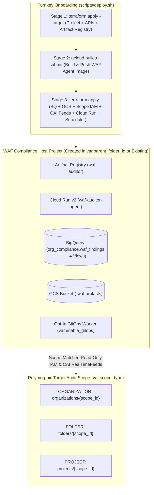

# Multi-Organization Portability & Turnkey Deployment Design

- **Date:** 2026-11-10
- **Status:** Draft — Pending User Spec Review
- **Target Repository:** `google-cloud-well-architected-framework-agent`

---

## 1. Purpose & Goals

Make the Autonomous Google Cloud Well-Architected Framework (WAF) Auditor architecture completely reusable and turnkey-deployable across any Google Cloud environment—without Google Cloud Marketplace dependencies or hardcoded organization/project identifiers.

### Core Requirements
1. **Dedicated Host Project Creation by Default (`terraform/project.tf`):**
   - By default (`create_compliance_project = true`), Terraform creates a dedicated WAF Compliance Host Project inside a user-specified GCP Folder (`parent_folder_id`, or under `org_id` if no folder is specified) and attaches `billing_account_id`.
   - Operators may optionally specify a custom `compliance_project_id` (if omitted during project creation, Terraform generates a globally unique ID `waf-compliance-<hex>`).
   - Operators who prefer to deploy into an existing project can set `create_compliance_project = false` and pass their existing `compliance_project_id`.
2. **Polymorphic Audit Scope (`ORGANIZATION`, `FOLDER`, or `PROJECT`):**
   - Support auditing an entire GCP Organization (`organizations/{ID}`), a specific Folder hierarchy (`folders/{ID}`), or a single Project (`projects/{ID}`) so engineering teams without Organization Admin rights can still deploy and run the WAF Auditor.
3. **Automated Host Bootstrap & Opt-In GitOps (`terraform/services.tf`, `terraform/gitops_cloudbuild.tf`):**
   - Automatically enable required GCP APIs and provision the Artifact Registry repository (`waf-auditor`) in the host project via Terraform.
   - Make Phase 4 GitOps Pull Request automation (`terraform/gitops_cloudbuild.tf`) opt-in via `enable_gitops = false` by default.
4. **Single Source of Truth Runtime Configuration (`app/config.py`):**
   - Eliminate conflicting hardcoded defaults (`legacy-waf-compliance-0`, `waf-compliance-hub`, `organizations/123456789`) across `app/main.py`, `app/gcp_tools.py`, `app/dashboard.py`, and `scripts/replay_drift.py`.
5. **Graceful Telemetry Degradation Across Diverse GCP Environments (`app/gcp_tools.py`):**
   - Support `organizations/*`, `folders/*`, and `projects/*` parents in `get_active_scc_findings`, and degrade gracefully with a structured warning when Security Command Center (SCC v2) or the Cloud Billing Carbon Footprint BigQuery export table is not enabled in the target environment.
   - Dynamically include discovered asset regions when querying Active Assist (`fetch_project_recommendations`) instead of restricting to `us-central1` and `us-east1`.
6. **Two-Stage Turnkey Bootstrap (`scripts/deploy.sh` & `terraform/terraform.tfvars.example`):**
   - Solve the Cloud Run initial container image dependency on brand-new projects by bootstrapping the project, APIs, and Artifact Registry first, building/pushing the container image via Cloud Build (or local Docker), and then converging the full Terraform configuration.

---

## 2. Architecture & Component Design



---

## 3. Terraform Infrastructure Specification (`terraform/`)

### 3.1 Provider Requirements (`terraform/versions.tf`)
Add `hashicorp/random` (`~> 3.6`) alongside `hashicorp/google` and `hashicorp/google-beta` (`~> 6.0`) to generate a 3-byte hex suffix when `create_compliance_project = true` and `compliance_project_id` is omitted.

### 3.2 Variables & Locals (`terraform/variables.tf` & `terraform/project.tf`)

| Variable | Type | Default | Description |
| :--- | :--- | :--- | :--- |
| `create_compliance_project` | `bool` | `true` | When `true`, creates a new dedicated GCP project for the WAF Auditor. When `false`, uses an existing project specified in `compliance_project_id`. |
| `compliance_project_id` | `string` | `""` | Custom project ID to create (when `create_compliance_project = true`) or existing project ID to use (when `create_compliance_project = false`). If empty and `create_compliance_project = true`, generates `waf-compliance-<6-char-hex>`. |
| `compliance_project_name` | `string` | `"WAF Compliance Hub"` | Display name for the created WAF Compliance Host Project. |
| `parent_folder_id` | `string` | `""` | Folder ID (e.g., `"987654321098"` or `"folders/987654321098"`) under which to create the WAF Compliance Host Project. |
| `billing_account_id` | `string` | `""` | Billing Account ID (`012345-6789AB-CDEF01`) required when `create_compliance_project = true`. |
| `org_id` | `string` | `""` | Optional numeric Organization ID. Used as fallback parent for project creation if `parent_folder_id` is empty, and as fallback `scope_id` if `scope_id` is empty. |
| `scope_type` | `string` | `"ORGANIZATION"` | Hierarchy level to audit: `"ORGANIZATION"`, `"FOLDER"`, or `"PROJECT"`. |
| `scope_id` | `string` | `""` | Target audit scope ID (numeric Org ID, numeric Folder ID, or Project ID). Falls back to `var.org_id` for `ORGANIZATION`, `var.parent_folder_id` for `FOLDER`, or `local.effective_project_id` for `PROJECT`. |
| `region` | `string` | `"us-central1"` | Primary GCP region for Cloud Run, BigQuery, Artifact Registry, and Cloud Scheduler. |
| `enable_realtime_feeds` | `bool` | `true` | Enables Cloud Asset Inventory RealTimeFeeds (`waf-high-risk-resource-drift` and `waf-iam-policy-drift`). |
| `enable_gitops` | `bool` | `false` | Enables Phase 4 GitOps Pull Request Cloud Build trigger, worker SA, and Secret Manager secret. |
| `carbon_export_table` | `string` | `""` | Optional full BigQuery table ID (`project.dataset.carbon_footprint`) for the Sustainability pillar. |

#### Computed Locals (`terraform/project.tf`)
```hcl
locals {
  clean_parent_folder_id = replace(var.parent_folder_id, "folders/", "")
  clean_org_id           = replace(var.org_id, "organizations/", "")

  generated_project_id = (
    var.compliance_project_id != ""
    ? var.compliance_project_id
    : "waf-compliance-${ coalesce(one(random_id.project_suffix[*].hex), "000000") }"
  )

  effective_project_id = (
    var.create_compliance_project
    ? google_project.waf_compliance[0].project_id
    : var.compliance_project_id
  )

  raw_scope_id = (
    var.scope_id != "" ? var.scope_id : (
      var.scope_type == "ORGANIZATION" ? local.clean_org_id : (
        var.scope_type == "FOLDER" ? local.clean_parent_folder_id : local.effective_project_id
      )
    )
  )

  clean_scope_id = replace(
    replace(replace(local.raw_scope_id, "organizations/", ""), "folders/", ""),
    "projects/",
    ""
  )

  scope_prefix_map = {
    ORGANIZATION = "organizations"
    FOLDER       = "folders"
    PROJECT      = "projects"
  }

  canonical_scope = "${local.scope_prefix_map[var.scope_type]}/${local.clean_scope_id}"
}
```

### 3.3 Host Project API Enablement & Artifact Registry (`terraform/services.tf`)
- **`google_project_service.required_apis`**:
  Enables core APIs on `local.effective_project_id`:
  - `serviceusage.googleapis.com`
  - `cloudresourcemanager.googleapis.com`
  - `iam.googleapis.com`
  - `run.googleapis.com`
  - `cloudasset.googleapis.com`
  - `bigquery.googleapis.com`
  - `storage.googleapis.com`
  - `aiplatform.googleapis.com`
  - `pubsub.googleapis.com`
  - `cloudscheduler.googleapis.com`
  - `artifactregistry.googleapis.com`
  - `recommender.googleapis.com`
  - `cloudbuild.googleapis.com` (needed for image build and optional GitOps)
  - `secretmanager.googleapis.com` (when `var.enable_gitops == true`)
- **`google_artifact_registry_repository.waf_auditor`**:
  Creates the `DOCKER` repository `waf-auditor` in `var.region` under `local.effective_project_id`, depending on `google_project_service.required_apis["artifactregistry.googleapis.com"]`.

### 3.4 Scope-Polymorphic Read-Only IAM (`terraform/iam.tf`)
Binds `local.org_readonly_roles` to `google_service_account.waf_auditor_sa.email` at the chosen scope:
- `google_organization_iam_member.org_readonly`: `for_each = var.scope_type == "ORGANIZATION" ? local.org_readonly_roles : toset([])`
- `google_folder_iam_member.folder_readonly`: `for_each = var.scope_type == "FOLDER" ? local.org_readonly_roles : toset([])` (using `folder = "folders/${local.clean_scope_id}"`)
- `google_project_iam_member.project_readonly`: `for_each = var.scope_type == "PROJECT" ? local.org_readonly_roles : toset([])` (using `project = local.clean_scope_id`)

### 3.5 Scope-Polymorphic Cloud Asset Inventory Feeds (`terraform/pubsub_cai.tf`)
When `var.enable_realtime_feeds == true`, provisions the two drift feeds (`waf-high-risk-resource-drift` and `waf-iam-policy-drift`) at the selected hierarchy level:
- `google_cloud_asset_organization_feed` (`count = var.enable_realtime_feeds && var.scope_type == "ORGANIZATION" ? 1 : 0`)
- `google_cloud_asset_folder_feed` (`count = var.enable_realtime_feeds && var.scope_type == "FOLDER" ? 1 : 0`)
- `google_cloud_asset_project_feed` (`count = var.enable_realtime_feeds && var.scope_type == "PROJECT" ? 1 : 0`)

### 3.6 Outputs (`terraform/outputs.tf`)
Exports:
- `compliance_project_id = local.effective_project_id`
- `region = var.region`
- `canonical_scope = local.canonical_scope`
- `artifact_registry_image = "${var.region}-docker.pkg.dev/${local.effective_project_id}/${google_artifact_registry_repository.waf_auditor.repository_id}/agent:latest"`
- `cloud_run_service_uri = google_cloud_run_v2_service.waf_auditor.uri`
- `bigquery_dataset = "${local.effective_project_id}.${google_bigquery_dataset.org_compliance.dataset_id}"`
- `gcs_artifact_bucket = google_storage_bucket.waf_artifacts.name`

---

## 4. Application & Runtime Configuration Specification (`app/`)

### 4.1 Centralized Config Module (`app/config.py`)
Provides a frozen dataclass `WAFConfig` and helper functions `get_waf_config()` and `normalize_scope(raw_scope, fallback_project)`:
- **`normalize_scope(raw_scope: str, fallback_project: str = "waf-compliance-hub") -> str`**:
  - Strips whitespace.
  - If `raw_scope` starts with `organizations/`, `folders/`, or `projects/`, returns it as-is.
  - If `raw_scope` is purely numeric (`^\d+$`), returns `f"organizations/{raw_scope}"` for backward compatibility.
  - If `raw_scope` is empty, returns `f"projects/{fallback_project}"`.
  - Otherwise, returns `f"projects/{raw_scope}"`.
- **`get_waf_config() -> WAFConfig`**:
  - `project_id`: `os.getenv("GOOGLE_CLOUD_PROJECT", "waf-compliance-hub")`
  - `quota_project_id`: `os.getenv("GOOGLE_CLOUD_QUOTA_PROJECT") or project_id`
  - `location`: `os.getenv("GOOGLE_CLOUD_LOCATION", "us-central1")`
  - `target_scope`: `normalize_scope(os.getenv("WAF_TARGET_SCOPE") or os.getenv("WAF_ORG_ID", "organizations/123456789"), project_id)`
  - `bq_table`: `os.getenv("WAF_BQ_TABLE", f"{project_id}.org_compliance.waf_findings")`
  - `gcs_bucket`: `os.getenv("WAF_GCS_BUCKET", f"{project_id}-waf-artifacts")`
  - `carbon_export_table`: `os.getenv("WAF_CARBON_EXPORT_TABLE", "")`
  - `recommender_locations`: deduplicated list parsed from `os.getenv("WAF_RECOMMENDER_LOCATIONS", "global,us-central1,us-east1,europe-west1,asia-east1")` plus `location`.

### 4.2 Resilient Multi-Scope Telemetry Tools (`app/gcp_tools.py`)
1. **`search_org_assets`**:
   - Records observed resource locations (`resource.location`) into `tool_context.state["observed_locations"]` (filtering out non-regional strings if needed) so downstream Recommender calls automatically query regions where the organization actually runs workloads.
2. **`get_active_scc_findings`**:
   - Uses `normalize_scope(org_id)` so `parent = f"{normalized_scope}/sources/-/locations/global"` supports `organizations/{id}`, `folders/{id}`, and `projects/{id}` natively.
   - Catches `Exception` (including `PermissionDenied`, `NotFound`, or disabled API) and returns `{"active_findings_count": 0, "findings": [], "warning": ...}` without failing the agent turn.
3. **`fetch_project_recommendations`**:
   - Combines caller `locations`, `get_waf_config().recommender_locations`, and `tool_context.state.get("observed_locations", [])` (preserving order and deduplicating) before querying Active Assist recommenders.
4. **`query_carbon_footprint_summary`**:
   - Resolves `table_id = billing_export_table or get_waf_config().carbon_export_table`.
   - If `table_id` is empty or the BigQuery query raises an exception (e.g., table not found or billing export not configured in the organization), returns:
     ```python
     {
         "hotspot_count": 0,
         "carbon_hotspots": [],
         "warning": (
             "Carbon Footprint BigQuery export table is not configured or accessible. "
             "Evaluate sustainability posture using resource locations (CFE%), idle resource signals, "
             "and architecture configurations returned by search_org_assets."
         ),
     }
     ```
5. **`commit_findings_to_bigquery_and_gcs`**:
   - Reads `bq_table` and `gcs_bucket_name` via `get_waf_config()` instead of hardcoding `legacy-waf-compliance-0`.

### 4.3 FastAPI Entrypoint, Dashboard & Skill Loader (`app/main.py`, `app/dashboard.py`, `app/skill_loader.py`)
- **`app/main.py`**: Uses `get_waf_config()` for `PROJECT_ID`, `LOCATION`, `DEFAULT_ORG_ID` (`cfg.target_scope`), and reads `WAF_GCS_BUCKET` directly from `os.getenv("WAF_GCS_BUCKET", "")` for `GcsArtifactService` (preserving `InMemoryArtifactService` fallback when `WAF_GCS_BUCKET` is unset in local unit tests).
- **`app/dashboard.py`**: Replaces all hardcoded `legacy-waf-compliance-0` references in `fetch_dashboard_telemetry` and `render_tufte_architecture_html` with dynamic values from `get_waf_config()`.
- **`app/skill_loader.py`**: Updates `build_pillar_instruction_provider` to label the scope as `Target Audit Scope: {org_id}` (supporting Organization, Folder, or Project scopes) and instructs sub-agents to rely on `search_org_assets` and `inspect_resource_configuration` whenever optional telemetry (SCC v2 or Carbon export) returns a warning.

---

## 5. Turnkey Bootstrap Script (`scripts/deploy.sh`) & Templates (`terraform/terraform.tfvars.example`)

### 5.1 `scripts/deploy.sh`
An executable, idempotent Bash script supporting flags `--tfvars <path>` (default `terraform/terraform.tfvars`), `--local-docker` (optional fallback if Cloud Build is restricted), and `--plan-only`:
1. Verifies `terraform` and `gcloud` CLI availability and checks for `terraform/terraform.tfvars`.
2. Runs `terraform -chdir=terraform init`.
3. **Stage 1 (Bootstrap Project, APIs & Artifact Registry):**
   Executes `terraform -chdir=terraform apply -auto-approve` targeting `random_id.project_suffix`, `google_project.waf_compliance`, `google_project_service.required_apis`, and `google_artifact_registry_repository.waf_auditor`.
4. Queries `PROJECT_ID=$(terraform -chdir=terraform output -raw compliance_project_id)` and `IMAGE_URI=$(terraform -chdir=terraform output -raw artifact_registry_image)`.
5. **Stage 2 (Container Build & Push):**
   Runs `gcloud builds submit . --project="${PROJECT_ID}" --tag="${IMAGE_URI}"` (or `docker build` + `docker push` when `--local-docker` is specified).
6. **Stage 3 (Full Infrastructure Convergence):**
   Executes `terraform -chdir=terraform apply -auto-approve` across all remaining resources.
7. Prints a summary table with the deployed Cloud Run URL, BigQuery dataset, GCS artifact bucket, and one-line commands to trigger an initial baseline sweep or view the dashboard.

### 5.2 `terraform/terraform.tfvars.example`
Includes documented configuration blocks for:
1. **Default Mode:** Creating a new WAF Compliance Host Project inside `parent_folder_id` with `billing_account_id` and auditing an Organization (`scope_type = "ORGANIZATION"`).
2. **Folder-Scoped Mode:** Creating a new WAF Compliance Host Project inside `parent_folder_id` and auditing a Folder (`scope_type = "FOLDER"`).
3. **Existing Project Mode:** Setting `create_compliance_project = false` and specifying an existing `compliance_project_id`.

---

## 6. Testing & Verification Strategy

1. **Unit Tests (`tests/test_multi_org_portability.py`):**
   - Verify `normalize_scope` handles `organizations/123`, bare numeric `123`, `folders/456`, `projects/my-proj`, and empty strings.
   - Verify `get_waf_config()` derives `bq_table` and `gcs_bucket` from `GOOGLE_CLOUD_PROJECT` with zero hardcoded `legacy-waf-compliance-0` strings.
   - Verify `get_active_scc_findings` formats parent resource names for `organizations/*`, `folders/*`, and `projects/*`, and returns a graceful `warning` dict on exceptions.
   - Verify `query_carbon_footprint_summary` returns a graceful `warning` dict when no table is configured or when BigQuery raises `NotFound`.
   - Verify `fetch_project_recommendations` merges `observed_locations` from `tool_context.state` with configured default locations.
2. **Existing Test Suite Regression Check:**
   - Ensure all existing unit and async integration tests in `tests/test_critic_validation.py`, `tests/test_critic_loop.py`, `tests/test_pubsub_push.py`, `tests/test_dashboard.py`, and `tests/test_gitops_pr.py` pass without modification.
3. **Terraform Validation:**
   - Run `terraform fmt -check`, `terraform init -backend=false`, and `terraform validate` in `terraform/` to verify all provider schemas, conditionals, and outputs.
