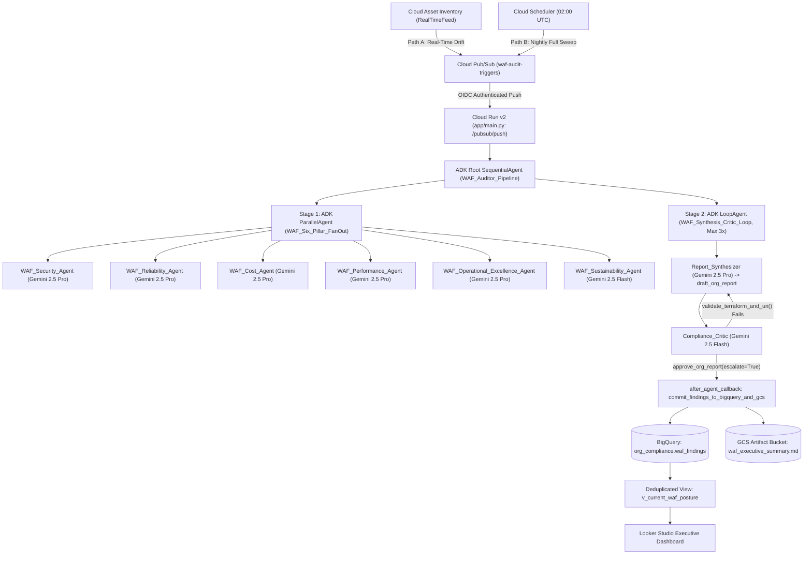
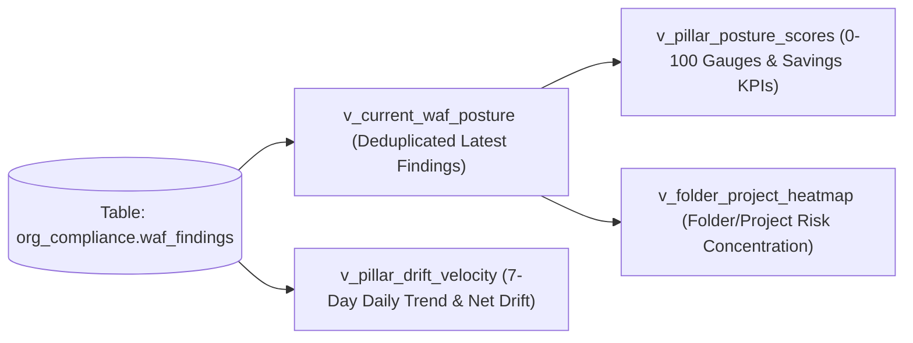
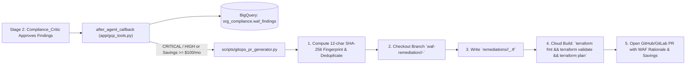

# System Design Plan: Autonomous Google Cloud Well-Architected Framework (WAF) Auditor

- **Architecture Pattern:** Event-Driven + Scheduled Multi-Agent System
- **Core Framework:** Google Agent Development Kit (ADK) — Python SDK (`google-adk`)
- **Knowledge Base:** Official Google Agent Skills (`google/skills` — `google-cloud-waf-*` + 165+ specialized GCP product skills)
- **Target Scope:** Google Cloud Organization Node (`organizations/{ORG_ID}`)
- **Compliance Host Project:** `waf-compliance-hub`

---

## 1. Executive Summary & Design Philosophy

Instead of relying on an LLM to parse raw JSON dumps of thousands of cloud resources—which drives up token costs and introduces hallucination risks—this architecture separates **deterministic telemetry gathering** from **agentic architectural reasoning**:

1. **Deterministic GCP Telemetry:** Native Google Cloud services (Cloud Asset Inventory, Security Command Center v2, Active Assist Recommender API, and Cloud Billing / Carbon Footprint BigQuery Exports) perform initial state detection, server-side filtering, and heuristic aggregation.
2. **Official WAF Skill Grounding:** Six specialized ADK `LlmAgent` sub-agents dynamically load Google's official `google-cloud-waf-*` skills ([`google-cloud-waf-security`](file:///Users/davezen1/projects/ai/google-cloud-well-architected-framework-agent/.agents/skills/google-cloud-waf-security/SKILL.md), [`google-cloud-waf-reliability`](file:///Users/davezen1/projects/ai/google-cloud-well-architected-framework-agent/.agents/skills/google-cloud-waf-reliability/SKILL.md), [`google-cloud-waf-cost-optimization`](file:///Users/davezen1/projects/ai/google-cloud-well-architected-framework-agent/.agents/skills/google-cloud-waf-cost-optimization/SKILL.md), [`google-cloud-waf-performance-optimization`](file:///Users/davezen1/projects/ai/google-cloud-well-architected-framework-agent/.agents/skills/google-cloud-waf-performance-optimization/SKILL.md), [`google-cloud-waf-operational-excellence`](file:///Users/davezen1/projects/ai/google-cloud-well-architected-framework-agent/.agents/skills/google-cloud-waf-operational-excellence/SKILL.md), and [`google-cloud-waf-sustainability`](file:///Users/davezen1/projects/ai/google-cloud-well-architected-framework-agent/.agents/skills/google-cloud-waf-sustainability/SKILL.md)) and progressively disclose `.md.txt` grounding documents or sibling product skills (`gke-*`, `bigquery-*`, `spanner-*`) on demand.
3. **Self-Correcting Synthesis:** A deterministic ADK `LoopAgent` pairs a `Report_Synthesizer` agent with a `Compliance_Critic` agent that deterministically verifies Cloud Asset Inventory resource URIs against observed telemetry, checks `python-hcl2` AST syntax on generated Terraform remediation blocks, and prevents attribution tag leakage before committing findings to BigQuery and Cloud Storage.

---

## 2. End-to-End Architecture



---

## 3. Trigger & Ingestion Layer

| Trigger Path | Source Service | Cadence | Target Scope & Filtering |
| :--- | :--- | :--- | :--- |
| **Path A: Real-Time Drift** | Cloud Asset Inventory (`google_cloud_asset_organization_feed`) | Continuous (Event-driven) | Two Org feeds (`RESOURCE` and `IAM_POLICY`) with CEL condition `!temporal_asset.deleted` restricting execution to high-risk mutations: `compute.googleapis.com/Firewall`, `container.googleapis.com/Cluster`, `sqladmin.googleapis.com/Instance`, and Org/Folder/Project IAM Policies. |
| **Path B: Baseline Sweep** | Cloud Scheduler (`google_cloud_scheduler_job`) | Every 24 hours (`0 2 * * *` UTC) | Evaluates full organizational posture across `organizations/{ORG_ID}`, catching non-event drift such as idle VMs, CUD coverage gaps, missing labels, and monthly carbon footprint shifts. |

---

## 4. Multi-Agent Topology & Skill Mapping

Each pillar sub-agent is instantiated inside an ADK `ParallelAgent` (`WAF_Six_Pillar_FanOut`), writes structured Pydantic outputs (`PillarEvaluationReport`) to its respective `output_key` in `session.state`, and loads its instructions dynamically from `./agent/skills/google-cloud-waf-*/SKILL.md`.

> [!IMPORTANT]
> **ADK `output_schema` + `tools` Requirement:** Whenever `output_schema` is set on an ADK `LlmAgent` that also uses tools, `disallow_transfer_to_parent=True` and `disallow_transfer_to_peers=True` must be explicitly enabled so ADK enforces structured schema decoding on the agent's final response after tool calls complete.

| ADK Agent Name | Model | Official Skill (`google/skills`) | Mapped Tools (`FunctionTool`) | `session.state` Key |
| :--- | :--- | :--- | :--- | :--- |
| `WAF_Security_Agent` | `gemini-2.5-pro` | [`google-cloud-waf-security`](file:///Users/davezen1/projects/ai/google-cloud-well-architected-framework-agent/.agents/skills/google-cloud-waf-security/SKILL.md) | `get_active_scc_findings`, `search_org_assets`, `inspect_resource_configuration`, `fetch_project_recommendations`, `read_waf_skill_reference` | `security_report` |
| `WAF_Reliability_Agent` | `gemini-2.5-pro` | [`google-cloud-waf-reliability`](file:///Users/davezen1/projects/ai/google-cloud-well-architected-framework-agent/.agents/skills/google-cloud-waf-reliability/SKILL.md) | `search_org_assets`, `inspect_resource_configuration`, `fetch_project_recommendations`, `read_waf_skill_reference` | `reliability_report` |
| `WAF_Cost_Agent` | `gemini-2.5-pro` | [`google-cloud-waf-cost-optimization`](file:///Users/davezen1/projects/ai/google-cloud-well-architected-framework-agent/.agents/skills/google-cloud-waf-cost-optimization/SKILL.md) | `fetch_project_recommendations`, `search_org_assets`, `read_waf_skill_reference` | `cost_report` |
| `WAF_Performance_Agent` | `gemini-2.5-pro` | [`google-cloud-waf-performance-optimization`](file:///Users/davezen1/projects/ai/google-cloud-well-architected-framework-agent/.agents/skills/google-cloud-waf-performance-optimization/SKILL.md) | `fetch_project_recommendations`, `search_org_assets`, `inspect_resource_configuration`, `read_waf_skill_reference` | `performance_report` |
| `WAF_Operational_Excellence_Agent` | `gemini-2.5-pro` | [`google-cloud-waf-operational-excellence`](file:///Users/davezen1/projects/ai/google-cloud-well-architected-framework-agent/.agents/skills/google-cloud-waf-operational-excellence/SKILL.md) | `search_org_assets`, `inspect_resource_configuration`, `read_waf_skill_reference` | `ops_report` |
| `WAF_Sustainability_Agent` | `gemini-2.5-flash` | [`google-cloud-waf-sustainability`](file:///Users/davezen1/projects/ai/google-cloud-well-architected-framework-agent/.agents/skills/google-cloud-waf-sustainability/SKILL.md) | `query_carbon_footprint_summary`, `search_org_assets`, `read_waf_skill_reference` | `sustainability_report` |

### Context Optimization via Progressive Disclosure
1. **Base Prompt (`InstructionProvider`):** Strips the interactive `## Workload assessment questions` section from `SKILL.md` (since the auditor runs headlessly) and injects the core rubric along with `org_id`, `scan_mode`, and `target_asset` from `ReadonlyContext`.
2. **On-Demand Deep Dives (`read_waf_skill_reference`):** Resolves both:
   - Official WAF Grounding Document URLs (`https://docs.cloud.google.com/architecture/framework/<pillar>/<principle>.md.txt`) cited in `SKILL.md` (cached locally in `./agent/skills/.grounding_cache/`).
   - Sibling workload skills in [`./agent/skills/`](file:///Users/davezen1/projects/ai/google-cloud-well-architected-framework-agent/agent/skills) (e.g., `gke-reliability/SKILL.md`, `bigquery-optimization/SKILL.md`).
3. **Usage Attribution Compliance ([`references/attribution.md`](file:///Users/davezen1/projects/ai/google-cloud-well-architected-framework-agent/.agents/skills/google-cloud-waf-security/references/attribution.md)):** Python SDK clients attach `ClientInfo(user_agent="agent-skills/1.0 (skill:<skill-name>)")` on API requests, while `validate_terraform_and_uri` ensures attribution strings are **never** leaked into generated Terraform HCL code.

---

## 5. Application Code Specifications (`app/`)

### 5.1 Data Contracts (`app/schemas.py`)

```python
from enum import Enum
from typing import List, Optional
from pydantic import BaseModel, Field


class WAFPillar(str, Enum):
    SECURITY = "SECURITY"
    RELIABILITY = "RELIABILITY"
    COST = "COST"
    PERFORMANCE = "PERFORMANCE"
    OPS = "OPS"
    SUSTAINABILITY = "SUSTAINABILITY"


class Severity(str, Enum):
    CRITICAL = "CRITICAL"
    HIGH = "HIGH"
    MEDIUM = "MEDIUM"
    LOW = "LOW"


class ComplianceStatus(str, Enum):
    NON_COMPLIANT = "NON_COMPLIANT"
    WARNING = "WARNING"


class WAFFinding(BaseModel):
    resource_uri: str = Field(
        description="Canonical Cloud Asset Inventory URI (e.g., //compute.googleapis.com/projects/p/zones/z/instances/i)"
    )
    project_id: str = Field(description="Owning GCP project ID")
    folder_id: Optional[str] = Field(default=None, description="Owning GCP folder ID if applicable")
    waf_pillar: WAFPillar
    waf_principle: str = Field(description="Exact core principle cited from the official SKILL.md")
    severity: Severity
    compliance_status: ComplianceStatus
    rationale: str = Field(
        description="Architectural explanation contextualized by resource configuration, labels, and environment"
    )
    terraform_remediation: str = Field(
        description="Valid, self-contained Terraform HCL resource/patch block to remediate the finding"
    )
    estimated_monthly_savings_usd: Optional[float] = Field(
        default=None, description="Projected monthly savings in USD (populated by Cost/Performance pillars)"
    )


class PillarEvaluationReport(BaseModel):
    waf_pillar: WAFPillar
    pillar_score: int = Field(ge=0, le=100, description="0-100 posture score for this pillar")
    evaluated_resource_count: int = Field(ge=0)
    findings: List[WAFFinding] = Field(default_factory=list)
    summary_notes: str


class OrganizationWAFReport(BaseModel):
    org_id: str
    scan_mode: str = Field(description="REALTIME_DRIFT | NIGHTLY_SWEEP")
    evaluation_timestamp: str
    overall_waf_score: int = Field(ge=0, le=100)
    pillar_scores: dict[str, int]
    top_architectural_risks: List[str]
    total_projected_monthly_savings_usd: float
    validated_findings: List[WAFFinding]
    executive_markdown: str = Field(description="Full Markdown narrative for GCS waf_executive_summary.md")
```

### 5.2 Skill Loader & Progressive Disclosure (`app/skill_loader.py`)

```python
import os
import re
import urllib.request
from pathlib import Path
from typing import Callable
import frontmatter
from google.adk.agents.readonly_context import ReadonlyContext

SKILLS_ROOT = Path(os.getenv("WAF_SKILLS_DIR", Path(__file__).resolve().parent.parent / "agent" / "skills"))
GROUNDING_CACHE_DIR = SKILLS_ROOT / ".grounding_cache"
ALLOWED_GROUNDING_PREFIX = "https://docs.cloud.google.com/architecture/framework/"


class WAFSkillLoader:
    """Loads, parses, and transforms official Google Cloud WAF skills for autonomous ADK execution."""

    _skill_cache: dict[str, tuple[dict, str]] = {}

    @classmethod
    def load_skill(cls, skill_dir_name: str) -> tuple[dict, str]:
        if skill_dir_name in cls._skill_cache:
            return cls._skill_cache[skill_dir_name]

        skill_path = SKILLS_ROOT / skill_dir_name / "SKILL.md"
        if not skill_path.exists():
            raise FileNotFoundError(f"Skill file not found: {skill_path}")

        post = frontmatter.load(skill_path)
        autonomous_body = re.sub(
            r"## Workload assessment questions.*?(?=\n## |\Z)",
            "",
            post.content,
            flags=re.DOTALL,
        )
        cls._skill_cache[skill_dir_name] = (post.metadata, autonomous_body.strip())
        return cls._skill_cache[skill_dir_name]


def build_pillar_instruction_provider(skill_dir_name: str) -> Callable[[ReadonlyContext], str]:
    """Builds an ADK InstructionProvider that injects SKILL.md + runtime session.state context."""

    def instruction_provider(ctx: ReadonlyContext) -> str:
        metadata, skill_markdown = WAFSkillLoader.load_skill(skill_dir_name)
        org_id = ctx.state.get("org_id", "organizations/UNKNOWN")
        scan_mode = ctx.state.get("scan_mode", "NIGHTLY_SWEEP")
        target_asset = ctx.state.get("target_asset", "ALL_ORG_ASSETS")

        return f"""You are an autonomous Google Cloud Well-Architected Framework (WAF) Auditor Agent
operating under skill `{metadata.get('name', skill_dir_name)}` (v{metadata.get('metadata', {}).get('version', '1.0')}).

### RUNTIME EXECUTION CONTEXT
- Organization Scope: `{org_id}`
- Scan Mode: `{scan_mode}`
- Target Asset Filter: `{target_asset}`

### AUTONOMOUS OPERATING RULES
1. DO NOT ask interactive questions. Infer workload criticality and environment from GCP resource labels (`env`, `tier`, `cost-center`), folders, and project naming conventions.
2. If `Scan Mode` is `REALTIME_DRIFT`, evaluate ONLY the mutated resource in `Target Asset Filter`. If the mutated asset type is not relevant to your pillar, return `findings=[]` and `pillar_score=100` immediately without calling unnecessary tools.
3. Every `waf_principle` you cite in a `WAFFinding` MUST match one of the exact bolded Core Principles in the Official Skill Rubric below.
4. When you need deeper architectural guidance on a specific principle URL (`https://docs.cloud.google.com/architecture/framework/.../*.md.txt`) or a specialized workload skill (e.g., `gke-reliability/SKILL.md`), call `read_waf_skill_reference`.
5. Produce valid, self-contained Terraform HCL in `terraform_remediation`. NEVER include `CLOUDSDK_METRICS_REQUEST_ATTRIBUTION` or `agent-skills/1.0` tracking tags inside generated Terraform HCL code.

### OFFICIAL SKILL RUBRIC ({skill_dir_name})
{skill_markdown}
"""

    return instruction_provider


def read_waf_skill_reference(reference_target: str) -> dict:
    """Progressive disclosure tool for sub-agents to fetch WAF grounding docs or specialized sibling skills."""
    if reference_target.startswith("https://"):
        if not reference_target.startswith(ALLOWED_GROUNDING_PREFIX) or not reference_target.endswith(".md.txt"):
            return {
                "status": "ERROR",
                "error": f"URL must start with {ALLOWED_GROUNDING_PREFIX} and end with .md.txt",
            }
        GROUNDING_CACHE_DIR.mkdir(parents=True, exist_ok=True)
        cache_key = reference_target.replace(ALLOWED_GROUNDING_PREFIX, "").replace("/", "__")
        cache_file = GROUNDING_CACHE_DIR / cache_key

        if cache_file.exists():
            return {"status": "OK", "source": "cache", "content": cache_file.read_text(encoding="utf-8")[:15000]}

        req = urllib.request.Request(
            reference_target,
            headers={"User-Agent": "WAF-Auditor-Agent/1.0 agent-skills/1.0"},
        )
        with urllib.request.urlopen(req, timeout=10) as resp:
            text = resp.read().decode("utf-8")
            cache_file.write_text(text, encoding="utf-8")
            return {"status": "OK", "source": "remote", "content": text[:15000]}

    safe_rel_path = Path(reference_target.lstrip("/"))
    resolved_path = (SKILLS_ROOT / safe_rel_path).resolve()
    if not str(resolved_path).startswith(str(SKILLS_ROOT.resolve())) or not resolved_path.is_file():
        return {"status": "ERROR", "error": f"Reference '{reference_target}' not found in vendored skills."}

    return {
        "status": "OK",
        "source": "vendored_skill",
        "content": resolved_path.read_text(encoding="utf-8")[:15000],
    }
```

### 5.3 Deterministic GCP Telemetry & Critic Tools (`app/gcp_tools.py`)

```python
import os
import re
from datetime import datetime, timezone
from typing import Optional

import hcl2
from google.adk.agents.callback_context import CallbackContext
from google.adk.tools import ToolContext
from google.api_core.gapic_v1.client_info import ClientInfo
from google.cloud import asset_v1, bigquery, recommender_v1, securitycenter_v2, storage
from google.protobuf.json_format import MessageToDict

CAI_URI_PATTERN = re.compile(r"^//[a-z0-9-]+\.googleapis\.com/.+$")

RECOMMENDER_MAP = {
    "SECURITY": ["google.iam.policy.Recommender"],
    "RELIABILITY": ["google.cloudsql.instance.ReliabilityRecommender"],
    "COST": [
        "google.compute.instance.IdleResourceRecommender",
        "google.compute.disk.IdleResourceRecommender",
        "google.compute.commitment.UsageCommitmentRecommender",
        "google.cloudsql.instance.IdleRecommender",
    ],
    "PERFORMANCE": [
        "google.compute.instance.MachineTypeRecommender",
        "google.cloudsql.instance.OverprovisionedRecommender",
    ],
}


def _client_info(skill_name: str = "google-cloud-waf-security") -> ClientInfo:
    return ClientInfo(user_agent=f"agent-skills/1.0 (skill:{skill_name})")


def search_org_assets(
    scope: str,
    asset_types: list[str],
    query: str = "",
    page_size: int = 50,
    tool_context: Optional[ToolContext] = None,
) -> dict:
    """Searches resources across the Organization or Project using Cloud Asset Inventory."""
    client = asset_v1.AssetServiceClient(client_info=_client_info())
    request = asset_v1.SearchAllResourcesRequest(
        scope=scope,
        asset_types=asset_types,
        query=query,
        page_size=min(page_size, 50),
    )

    results = []
    known_uris = set(tool_context.state.get("observed_resource_uris", [])) if tool_context else set()

    for resource in client.search_all_resources(request=request):
        results.append({
            "resource_uri": resource.name,
            "asset_type": resource.asset_type,
            "project": resource.project,
            "folders": list(resource.folders),
            "location": resource.location,
            "labels": dict(resource.labels),
            "state": resource.state,
        })
        known_uris.add(resource.name)
        if len(results) >= min(page_size, 50):
            break

    if tool_context is not None:
        tool_context.state["observed_resource_uris"] = list(known_uris)

    return {"count": len(results), "resources": results}


def inspect_resource_configuration(
    scope: str,
    resource_uris: list[str],
    content_type: str = "RESOURCE",
) -> dict:
    """Fetches full configuration or IAM policy for specific resource URIs via CAI BatchGetAssetsHistory."""
    client = asset_v1.AssetServiceClient(client_info=_client_info())
    enum_map = {
        "RESOURCE": asset_v1.ContentType.RESOURCE,
        "IAM_POLICY": asset_v1.ContentType.IAM_POLICY,
        "ORG_POLICY": asset_v1.ContentType.ORG_POLICY,
    }
    response = client.batch_get_assets_history(
        request=asset_v1.BatchGetAssetsHistoryRequest(
            parent=scope,
            asset_names=resource_uris[:20],
            content_type=enum_map.get(content_type, asset_v1.ContentType.RESOURCE),
        )
    )

    configs = []
    for temporal_asset in response.assets:
        asset_dict = MessageToDict(temporal_asset.asset._pb)
        configs.append({
            "resource_uri": temporal_asset.asset.name,
            "asset_type": temporal_asset.asset.asset_type,
            "resource_data": asset_dict.get("resource", {}).get("data", {}),
            "iam_policy": asset_dict.get("iamPolicy", {}),
        })
    return {"inspected_count": len(configs), "configurations": configs}


def get_active_scc_findings(
    org_id: str,
    min_severity: str = "HIGH",
    max_results: int = 50,
    tool_context: Optional[ToolContext] = None,
) -> dict:
    """Queries active Security Command Center (SCC v2) findings."""
    clean_org = org_id.replace("organizations/", "")
    parent = f"organizations/{clean_org}/sources/-/locations/global"
    client = securitycenter_v2.SecurityCenterClient(client_info=_client_info("google-cloud-waf-security"))

    severity_filter = (
        'severity="CRITICAL"'
        if min_severity == "CRITICAL"
        else '(severity="CRITICAL" OR severity="HIGH")'
    )
    filter_str = f'state="ACTIVE" AND {severity_filter}'

    findings = []
    known_uris = set(tool_context.state.get("observed_resource_uris", [])) if tool_context else set()

    request = securitycenter_v2.ListFindingsRequest(
        parent=parent,
        filter=filter_str,
        page_size=min(max_results, 50),
    )
    for item in client.list_findings(request=request):
        finding = item.finding
        known_uris.add(finding.resource_name)
        findings.append({
            "finding_name": finding.name,
            "category": finding.category,
            "finding_class": finding.finding_class.name,
            "severity": finding.severity.name,
            "resource_uri": finding.resource_name,
            "description": finding.description,
            "next_steps": finding.next_steps,
        })
        if len(findings) >= min(max_results, 50):
            break

    if tool_context is not None:
        tool_context.state["observed_resource_uris"] = list(known_uris)

    return {"active_findings_count": len(findings), "findings": findings}


def fetch_project_recommendations(
    project_id: str,
    pillar_category: str,
    locations: list[str] = ["global", "us-central1", "us-east1"],
    tool_context: Optional[ToolContext] = None,
) -> dict:
    """Fetches Active Assist recommendations for a project mapped to a WAF pillar category."""
    client = recommender_v1.RecommenderClient(client_info=_client_info())
    recommender_ids = RECOMMENDER_MAP.get(pillar_category.upper(), [])
    recommendations = []
    known_uris = set(tool_context.state.get("observed_resource_uris", [])) if tool_context else set()

    for loc in locations:
        for rec_id in recommender_ids:
            parent = f"projects/{project_id}/locations/{loc}/recommenders/{rec_id}"
            try:
                for rec in client.list_recommendations(parent=parent):
                    if rec.state_info.state != recommender_v1.RecommendationStateInfo.State.ACTIVE:
                        continue
                    impact = rec.primary_impact
                    cost_usd = None
                    if impact.cost_projection and impact.cost_projection.cost:
                        cost_usd = abs(
                            impact.cost_projection.cost.units
                            + impact.cost_projection.cost.nanos / 1e9
                        )
                    target_resources = list(rec.content.overview.get("resourceNames", []))
                    for uri in target_resources:
                        known_uris.add(uri)

                    recommendations.append({
                        "recommender_id": rec_id,
                        "description": rec.description,
                        "recommender_subtype": rec.recommender_subtype,
                        "priority": rec.priority.name,
                        "target_resources": target_resources,
                        "estimated_monthly_savings_usd": cost_usd,
                    })
            except Exception:
                continue

    if tool_context is not None:
        tool_context.state["observed_resource_uris"] = list(known_uris)

    return {"count": len(recommendations), "recommendations": recommendations}


def query_carbon_footprint_summary(
    billing_export_table: str,
    months_lookback: int = 3,
) -> dict:
    """Queries the Google Cloud Carbon Footprint BigQuery export grouped by project, service, and region."""
    bq_client = bigquery.Client(client_info=_client_info("google-cloud-waf-sustainability"))
    query = f"""
        SELECT
            project.id AS project_id,
            service.description AS service_name,
            location.region AS region,
            ROUND(SUM(carbon_footprint_total_kgCO2e.location_based), 2) AS location_based_kg_co2e,
            ROUND(SUM(carbon_footprint_total_kgCO2e.market_based), 2) AS market_based_kg_co2e
        FROM `{billing_export_table}`
        WHERE usage_month >= DATE_SUB(DATE_TRUNC(CURRENT_DATE(), MONTH), INTERVAL @months MONTH)
        GROUP BY 1, 2, 3
        ORDER BY location_based_kg_co2e DESC
        LIMIT 50
    """
    job_config = bigquery.QueryJobConfig(
        query_parameters=[bigquery.ScalarQueryParameter("months", "INT64", months_lookback)]
    )
    rows = [dict(row) for row in bq_client.query(query, job_config=job_config).result()]
    return {"hotspot_count": len(rows), "carbon_hotspots": rows}


def validate_terraform_and_uri(
    resource_uri: str,
    terraform_hcl: str,
    tool_context: ToolContext,
) -> dict:
    """Deterministically validates a WAFFinding's CAI resource URI and parses its Terraform HCL AST."""
    errors = []

    if not CAI_URI_PATTERN.match(resource_uri):
        errors.append(
            f"Invalid CAI URI format '{resource_uri}'. Must start with '//<service>.googleapis.com/'."
        )
    observed = set(tool_context.state.get("observed_resource_uris", []))
    if observed and resource_uri not in observed:
        errors.append(
            f"Hallucinated URI '{resource_uri}': resource was not returned by any CAI, SCC, or Recommender tool call."
        )

    if "agent-skills/1.0" in terraform_hcl or "CLOUDSDK_METRICS_REQUEST_ATTRIBUTION" in terraform_hcl:
        errors.append("Forbidden attribution tag found inside generated Terraform HCL.")

    try:
        parsed = hcl2.loads(terraform_hcl)
        if not parsed:
            errors.append("Terraform HCL parsed to an empty block.")
    except Exception as exc:
        errors.append(f"Terraform HCL syntax error: {exc}")

    return {"is_valid": len(errors) == 0, "errors": errors}


def commit_findings_to_bigquery_and_gcs(callback_context: CallbackContext) -> None:
    """Root SequentialAgent after_agent_callback: writes validated findings to BigQuery and Markdown to GCS."""
    report = callback_context.state.get("final_org_report") or callback_context.state.get("draft_org_report")
    if not report:
        return

    bq_table = os.getenv("WAF_BQ_TABLE", "waf-compliance-hub.org_compliance.waf_findings")
    gcs_bucket_name = os.getenv("WAF_GCS_BUCKET", "waf-compliance-hub-waf-artifacts")
    now_iso = datetime.now(timezone.utc).isoformat()

    findings = report.get("validated_findings", [])
    if findings:
        bq_client = bigquery.Client()
        rows_to_insert = [
            {
                "evaluation_timestamp": now_iso,
                "org_id": report.get("org_id", ""),
                "scan_mode": report.get("scan_mode", "NIGHTLY_SWEEP"),
                "resource_uri": f["resource_uri"],
                "project_id": f["project_id"],
                "folder_id": f.get("folder_id"),
                "waf_pillar": f["waf_pillar"],
                "waf_principle": f["waf_principle"],
                "severity": f["severity"],
                "compliance_status": f["compliance_status"],
                "rationale": f["rationale"],
                "terraform_remediation": f["terraform_remediation"],
                "estimated_monthly_savings_usd": f.get("estimated_monthly_savings_usd"),
            }
            for f in findings
        ]
        bq_client.insert_rows_json(bq_table, rows_to_insert)

    exec_md = report.get("executive_markdown", "")
    if exec_md and gcs_bucket_name:
        storage_client = storage.Client()
        bucket = storage_client.bucket(gcs_bucket_name)
        blob = bucket.blob("reports/waf_executive_summary.md")
        blob.upload_from_string(exec_md, content_type="text/markdown")
```

### 5.4 Multi-Agent Pipeline Definition (`app/agent.py`)

```python
from google.adk.agents import LlmAgent, LoopAgent, ParallelAgent, SequentialAgent
from google.adk.tools import ToolContext

from .gcp_tools import (
    commit_findings_to_bigquery_and_gcs,
    fetch_project_recommendations,
    get_active_scc_findings,
    inspect_resource_configuration,
    query_carbon_footprint_summary,
    search_org_assets,
    validate_terraform_and_uri,
)
from .schemas import OrganizationWAFReport, PillarEvaluationReport
from .skill_loader import build_pillar_instruction_provider, read_waf_skill_reference


def approve_org_report(tool_context: ToolContext) -> dict:
    """Called by Compliance_Critic when all findings and HCL blocks pass validation."""
    tool_context.state["final_org_report"] = tool_context.state.get("draft_org_report")
    tool_context.actions.escalate = True
    return {"status": "APPROVED", "message": "Exiting critic loop."}


def create_pillar_agent(
    name: str,
    model: str,
    skill_dir_name: str,
    tools: list,
    output_key: str,
) -> LlmAgent:
    return LlmAgent(
        name=name,
        model=model,
        instruction=build_pillar_instruction_provider(skill_dir_name),
        tools=tools,
        output_schema=PillarEvaluationReport,
        output_key=output_key,
        disallow_transfer_to_parent=True,
        disallow_transfer_to_peers=True,
    )


waf_six_pillar_fanout = ParallelAgent(
    name="WAF_Six_Pillar_FanOut",
    sub_agents=[
        create_pillar_agent(
            name="WAF_Security_Agent",
            model="gemini-2.5-pro",
            skill_dir_name="google-cloud-waf-security",
            tools=[
                get_active_scc_findings,
                search_org_assets,
                inspect_resource_configuration,
                fetch_project_recommendations,
                read_waf_skill_reference,
            ],
            output_key="security_report",
        ),
        create_pillar_agent(
            name="WAF_Reliability_Agent",
            model="gemini-2.5-pro",
            skill_dir_name="google-cloud-waf-reliability",
            tools=[
                search_org_assets,
                inspect_resource_configuration,
                fetch_project_recommendations,
                read_waf_skill_reference,
            ],
            output_key="reliability_report",
        ),
        create_pillar_agent(
            name="WAF_Cost_Agent",
            model="gemini-2.5-pro",
            skill_dir_name="google-cloud-waf-cost-optimization",
            tools=[
                fetch_project_recommendations,
                search_org_assets,
                read_waf_skill_reference,
            ],
            output_key="cost_report",
        ),
        create_pillar_agent(
            name="WAF_Performance_Agent",
            model="gemini-2.5-pro",
            skill_dir_name="google-cloud-waf-performance-optimization",
            tools=[
                fetch_project_recommendations,
                search_org_assets,
                inspect_resource_configuration,
                read_waf_skill_reference,
            ],
            output_key="performance_report",
        ),
        create_pillar_agent(
            name="WAF_Operational_Excellence_Agent",
            model="gemini-2.5-pro",
            skill_dir_name="google-cloud-waf-operational-excellence",
            tools=[
                search_org_assets,
                inspect_resource_configuration,
                read_waf_skill_reference,
            ],
            output_key="ops_report",
        ),
        create_pillar_agent(
            name="WAF_Sustainability_Agent",
            model="gemini-2.5-flash",
            skill_dir_name="google-cloud-waf-sustainability",
            tools=[
                query_carbon_footprint_summary,
                search_org_assets,
                read_waf_skill_reference,
            ],
            output_key="sustainability_report",
        ),
    ],
)

report_synthesizer = LlmAgent(
    name="Report_Synthesizer",
    model="gemini-2.5-pro",
    instruction="""You are the Lead Cloud Architect Synthesizer.
Combine the six pillar reports from session state:
- Security: {security_report}
- Reliability: {reliability_report}
- Cost: {cost_report}
- Performance: {performance_report}
- Operational Excellence: {ops_report}
- Sustainability: {sustainability_report}

If critic feedback is present in {critic_feedback?}, resolve every flagged URI or Terraform HCL error.
Produce a unified OrganizationWAFReport.""",
    output_schema=OrganizationWAFReport,
    output_key="draft_org_report",
    disallow_transfer_to_parent=True,
    disallow_transfer_to_peers=True,
)

compliance_critic = LlmAgent(
    name="Compliance_Critic",
    model="gemini-2.5-flash",
    instruction="""You are the WAF Compliance Critic.
Inspect {draft_org_report}.
1. Call `validate_terraform_and_uri` for each finding in `validated_findings`.
2. Verify that every `waf_principle` matches an authentic principle from the pillar reports.
3. If ALL findings pass validation, call `approve_org_report` immediately.
4. Otherwise, summarize the exact errors so Report_Synthesizer can fix them on the next iteration.""",
    tools=[validate_terraform_and_uri, approve_org_report],
    output_key="critic_feedback",
)

synthesis_loop = LoopAgent(
    name="WAF_Synthesis_Critic_Loop",
    sub_agents=[report_synthesizer, compliance_critic],
    max_iterations=3,
)

root_agent = SequentialAgent(
    name="WAF_Auditor_Pipeline",
    sub_agents=[waf_six_pillar_fanout, synthesis_loop],
    after_agent_callback=commit_findings_to_bigquery_and_gcs,
)
```

### 5.5 FastAPI Cloud Run Push Endpoint (`app/main.py`)

```python
import base64
import json
import os
import uuid
from fastapi import FastAPI, HTTPException, Request
from google.adk.artifacts import GcsArtifactService, InMemoryArtifactService
from google.adk.runners import Runner
from google.adk.sessions import InMemorySessionService
from google.genai import types

from .agent import root_agent

APP_NAME = "waf_auditor_agent"
DEFAULT_ORG_ID = os.getenv("WAF_ORG_ID", "organizations/123456789")
GCS_ARTIFACT_BUCKET = os.getenv("WAF_GCS_BUCKET", "")

app = FastAPI(title="Autonomous Google Cloud WAF Auditor")

session_service = InMemorySessionService()
artifact_service = (
    GcsArtifactService(bucket_name=GCS_ARTIFACT_BUCKET)
    if GCS_ARTIFACT_BUCKET
    else InMemoryArtifactService()
)

runner = Runner(
    agent=root_agent,
    app_name=APP_NAME,
    session_service=session_service,
    artifact_service=artifact_service,
)


def _parse_pubsub_envelope(body: dict) -> dict:
    message = body.get("message", {})
    raw_data = message.get("data", "")
    if not raw_data:
        return {}
    decoded_bytes = base64.b64decode(raw_data)
    return json.loads(decoded_bytes.decode("utf-8"))


@app.post("/pubsub/push")
async def handle_pubsub_push(request: Request):
    """Unified Cloud Run push endpoint for CAI RealTimeFeed (Path A) & Cloud Scheduler (Path B)."""
    try:
        envelope = await request.json()
        payload = _parse_pubsub_envelope(envelope)
    except Exception as exc:
        raise HTTPException(status_code=400, detail=f"Invalid Pub/Sub push payload: {exc}")

    if "asset" in payload:
        scan_mode = "REALTIME_DRIFT"
        asset_info = payload["asset"]
        asset_uri = asset_info.get("name", "")
        asset_type = asset_info.get("assetType", "")
        initial_state = {
            "org_id": DEFAULT_ORG_ID,
            "scan_mode": scan_mode,
            "target_asset": json.dumps(asset_info),
            "observed_resource_uris": [asset_uri] if asset_uri else [],
        }
        prompt_text = (
            f"Evaluate real-time Cloud Asset Inventory drift event for `{asset_uri}` "
            f"(type `{asset_type}`) against the Google Cloud Well-Architected Framework."
        )
    else:
        scan_mode = payload.get("scan_mode", "NIGHTLY_SWEEP")
        org_id = payload.get("org_id", DEFAULT_ORG_ID)
        initial_state = {
            "org_id": org_id,
            "scan_mode": scan_mode,
            "target_asset": "ALL_ORG_ASSETS",
            "observed_resource_uris": [],
        }
        prompt_text = (
            f"Execute a full organizational Well-Architected Framework baseline sweep "
            f"across `{org_id}` covering all 6 WAF pillars."
        )

    session_id = f"waf-{scan_mode.lower()}-{uuid.uuid4().hex[:10]}"
    user_id = "system-scheduler"

    await session_service.create_session(
        app_name=APP_NAME,
        user_id=user_id,
        session_id=session_id,
        state=initial_state,
    )

    user_message = types.Content(
        role="user",
        parts=[types.Part.from_text(text=prompt_text)],
    )

    async for _ in runner.run_async(
        user_id=user_id,
        session_id=session_id,
        new_message=user_message,
    ):
        pass

    updated_session = await session_service.get_session(
        app_name=APP_NAME, user_id=user_id, session_id=session_id
    )
    final_report = updated_session.state.get("final_org_report") or updated_session.state.get("draft_org_report")
    if final_report and final_report.get("executive_markdown"):
        md_bytes = final_report["executive_markdown"].encode("utf-8")
        await artifact_service.save_artifact(
            app_name=APP_NAME,
            user_id=user_id,
            session_id=session_id,
            filename="waf_executive_summary.md",
            artifact=types.Part.from_bytes(data=md_bytes, mime_type="text/markdown"),
        )

    return {
        "status": "COMPLETED",
        "session_id": session_id,
        "scan_mode": scan_mode,
        "findings_committed": len(final_report.get("validated_findings", [])) if final_report else 0,
    }
```

---

## 6. Infrastructure as Code (`terraform/`)

### 6.1 Organization & Host Project IAM (`terraform/iam.tf`)

```hcl
variable "org_id" {
  type        = string
  description = "Numeric Google Cloud Organization ID"
}

variable "compliance_project_id" {
  type        = string
  default     = "waf-compliance-hub"
  description = "Compliance Host Project ID"
}

variable "region" {
  type    = string
  default = "us-central1"
}

locals {
  org_readonly_roles = toset([
    "roles/cloudasset.viewer",
    "roles/securitycenter.findingsViewer",
    "roles/recommender.viewer",
    "roles/monitoring.viewer",
    "roles/cloudconfig.viewer",
    "roles/browser",
  ])
}

resource "google_service_account" "waf_auditor_sa" {
  project      = var.compliance_project_id
  account_id   = "waf-auditor-sa"
  display_name = "Autonomous WAF Auditor Runtime SA"
}

resource "google_organization_iam_member" "org_readonly" {
  for_each = local.org_readonly_roles
  org_id   = var.org_id
  role     = each.value
  member   = "serviceAccount:${google_service_account.waf_auditor_sa.email}"
}

resource "google_project_iam_member" "vertex_ai_user" {
  project = var.compliance_project_id
  role    = "roles/aiplatform.user"
  member  = "serviceAccount:${google_service_account.waf_auditor_sa.email}"
}

resource "google_bigquery_dataset_iam_member" "bq_dataset_writer" {
  project    = var.compliance_project_id
  dataset_id = google_bigquery_dataset.org_compliance.dataset_id
  role       = "roles/bigquery.dataEditor"
  member     = "serviceAccount:${google_service_account.waf_auditor_sa.email}"
}

resource "google_project_iam_member" "bq_job_user" {
  project = var.compliance_project_id
  role    = "roles/bigquery.jobUser"
  member  = "serviceAccount:${google_service_account.waf_auditor_sa.email}"
}

resource "google_storage_bucket" "waf_artifacts" {
  project                     = var.compliance_project_id
  name                        = "${var.compliance_project_id}-waf-artifacts"
  location                    = var.region
  uniform_bucket_level_access = true
  versioning {
    enabled = true
  }
}

resource "google_storage_bucket_iam_member" "gcs_artifact_admin" {
  bucket = google_storage_bucket.waf_artifacts.name
  role   = "roles/storage.objectAdmin"
  member = "serviceAccount:${google_service_account.waf_auditor_sa.email}"
}
```

### 6.2 Cloud Asset Inventory RealTimeFeeds (`terraform/pubsub_cai.tf`)

```hcl
resource "google_pubsub_topic" "waf_audit_triggers" {
  project = var.compliance_project_id
  name    = "waf-audit-triggers"
}

resource "google_project_service_identity" "cai_identity" {
  provider = google-beta
  project  = var.compliance_project_id
  service  = "cloudasset.googleapis.com"
}

resource "google_pubsub_topic_iam_member" "cai_publisher" {
  project = var.compliance_project_id
  topic   = google_pubsub_topic.waf_audit_triggers.name
  role    = "roles/pubsub.publisher"
  member  = "serviceAccount:${google_project_service_identity.cai_identity.email}"
}

resource "google_cloud_asset_organization_feed" "high_risk_resources" {
  billing_project = var.compliance_project_id
  org_id          = var.org_id
  feed_id         = "waf-high-risk-resource-drift"
  content_type    = "RESOURCE"

  asset_types = [
    "compute.googleapis.com/Firewall",
    "container.googleapis.com/Cluster",
    "sqladmin.googleapis.com/Instance",
  ]

  feed_output_config {
    pubsub_destination {
      topic = google_pubsub_topic.waf_audit_triggers.id
    }
  }

  condition {
    title      = "Exclude deleted resources"
    expression = "!temporal_asset.deleted"
  }
}

resource "google_cloud_asset_organization_feed" "iam_policy_drift" {
  billing_project = var.compliance_project_id
  org_id          = var.org_id
  feed_id         = "waf-iam-policy-drift"
  content_type    = "IAM_POLICY"

  asset_types = [
    "cloudresourcemanager.googleapis.com/Project",
    "cloudresourcemanager.googleapis.com/Folder",
    "cloudresourcemanager.googleapis.com/Organization",
  ]

  feed_output_config {
    pubsub_destination {
      topic = google_pubsub_topic.waf_audit_triggers.id
    }
  }

  condition {
    title      = "Active IAM policy changes only"
    expression = "!temporal_asset.deleted"
  }
}
```

### 6.3 BigQuery Partitioned Ledger & Deduplicated View (`terraform/bigquery.tf`)

```hcl
resource "google_bigquery_dataset" "org_compliance" {
  project                    = var.compliance_project_id
  dataset_id                 = "org_compliance"
  friendly_name              = "Organization WAF Compliance Telemetry"
  location                   = var.region
  delete_contents_on_destroy = false
}

resource "google_bigquery_table" "waf_findings" {
  project             = var.compliance_project_id
  dataset_id          = google_bigquery_dataset.org_compliance.dataset_id
  table_id            = "waf_findings"
  deletion_protection = true

  time_partitioning {
    type  = "DAY"
    field = "evaluation_timestamp"
  }

  clustering = ["waf_pillar", "project_id", "severity"]

  schema = jsonencode([
    { name = "evaluation_timestamp", type = "TIMESTAMP", mode = "REQUIRED" },
    { name = "org_id", type = "STRING", mode = "REQUIRED" },
    { name = "scan_mode", type = "STRING", mode = "REQUIRED" },
    { name = "resource_uri", type = "STRING", mode = "REQUIRED" },
    { name = "project_id", type = "STRING", mode = "REQUIRED" },
    { name = "folder_id", type = "STRING", mode = "NULLABLE" },
    { name = "waf_pillar", type = "STRING", mode = "REQUIRED" },
    { name = "waf_principle", type = "STRING", mode = "REQUIRED" },
    { name = "severity", type = "STRING", mode = "REQUIRED" },
    { name = "compliance_status", type = "STRING", mode = "REQUIRED" },
    { name = "rationale", type = "STRING", mode = "REQUIRED" },
    { name = "terraform_remediation", type = "STRING", mode = "REQUIRED" },
    { name = "estimated_monthly_savings_usd", type = "FLOAT64", mode = "NULLABLE" }
  ])
}

resource "google_bigquery_table" "v_current_waf_posture" {
  project             = var.compliance_project_id
  dataset_id          = google_bigquery_dataset.org_compliance.dataset_id
  table_id            = "v_current_waf_posture"
  deletion_protection = false

  view {
    use_legacy_sql = false
    query          = <<-SQL
      SELECT
        evaluation_timestamp,
        org_id,
        scan_mode,
        resource_uri,
        project_id,
        folder_id,
        waf_pillar,
        waf_principle,
        severity,
        compliance_status,
        rationale,
        terraform_remediation,
        COALESCE(estimated_monthly_savings_usd, 0.0) AS estimated_monthly_savings_usd
      FROM `${var.compliance_project_id}.${google_bigquery_dataset.org_compliance.dataset_id}.${google_bigquery_table.waf_findings.table_id}`
      WHERE evaluation_timestamp >= TIMESTAMP_SUB(CURRENT_TIMESTAMP(), INTERVAL 30 DAY)
      QUALIFY ROW_NUMBER() OVER (
        PARTITION BY resource_uri, waf_pillar, waf_principle
        ORDER BY evaluation_timestamp DESC
      ) = 1
    SQL
  }
}
```

### 6.4 Cloud Run v2 Service & Nightly Scheduler (`terraform/cloud_run.tf`)

```hcl
resource "google_cloud_run_v2_service" "waf_auditor" {
  project  = var.compliance_project_id
  name     = "waf-auditor-agent"
  location = var.region
  ingress  = "INGRESS_TRAFFIC_INTERNAL_ONLY"

  template {
    service_account = google_service_account.waf_auditor_sa.email
    timeout         = "600s"

    scaling {
      min_instance_count = 0
      max_instance_count = 10
    }

    containers {
      image = "${var.region}-docker.pkg.dev/${var.compliance_project_id}/waf-auditor/agent:latest"

      resources {
        limits = {
          cpu    = "2"
          memory = "2Gi"
        }
        cpu_idle = false
      }

      env {
        name  = "GOOGLE_GENAI_USE_VERTEXAI"
        value = "TRUE"
      }
      env {
        name  = "GOOGLE_CLOUD_PROJECT"
        value = var.compliance_project_id
      }
      env {
        name  = "GOOGLE_CLOUD_LOCATION"
        value = var.region
      }
      env {
        name  = "WAF_ORG_ID"
        value = "organizations/${var.org_id}"
      }
      env {
        name  = "WAF_BQ_TABLE"
        value = "${var.compliance_project_id}.${google_bigquery_dataset.org_compliance.dataset_id}.${google_bigquery_table.waf_findings.table_id}"
      }
      env {
        name  = "WAF_GCS_BUCKET"
        value = google_storage_bucket.waf_artifacts.name
      }
    }
  }
}

resource "google_service_account" "waf_invoker_sa" {
  project      = var.compliance_project_id
  account_id   = "waf-pubsub-invoker-sa"
  display_name = "WAF Auditor Cloud Run Push Invoker"
}

resource "google_cloud_run_v2_service_iam_member" "allow_pubsub_invoker" {
  project  = var.compliance_project_id
  location = var.region
  name     = google_cloud_run_v2_service.waf_auditor.name
  role     = "roles/run.invoker"
  member   = "serviceAccount:${google_service_account.waf_invoker_sa.email}"
}

resource "google_pubsub_subscription" "waf_push_sub" {
  project              = var.compliance_project_id
  name                 = "waf-auditor-push-sub"
  topic                = google_pubsub_topic.waf_audit_triggers.name
  ack_deadline_seconds = 600

  push_config {
    push_endpoint = "${google_cloud_run_v2_service.waf_auditor.uri}/pubsub/push"
    oidc_token {
      service_account_email = google_service_account.waf_invoker_sa.email
    }
  }

  retry_policy {
    minimum_backoff = "10s"
    maximum_backoff = "600s"
  }
}

resource "google_cloud_scheduler_job" "nightly_waf_sweep" {
  project   = var.compliance_project_id
  name      = "waf-nightly-baseline-sweep"
  region    = var.region
  schedule  = "0 2 * * *"
  time_zone = "Etc/UTC"

  pubsub_target {
    topic_name = google_pubsub_topic.waf_audit_triggers.id
    data = base64encode(jsonencode({
      scan_mode = "NIGHTLY_SWEEP"
      org_id    = "organizations/${var.org_id}"
    }))
  }
}
```

### 6.5 Packaging (`pyproject.toml` & `Dockerfile`)

````carousel
```toml
# pyproject.toml
[project]
name = "waf-auditor-agent"
version = "0.1.0"
description = "Autonomous Google Cloud Well-Architected Framework (WAF) Multi-Agent Auditor"
readme = "README.md"
requires-python = ">=3.12"
dependencies = [
    "google-adk>=1.0.0",
    "google-genai>=1.0.0",
    "google-cloud-asset>=3.26.0",
    "google-cloud-securitycenter>=1.32.0",
    "google-cloud-recommender>=2.16.0",
    "google-cloud-bigquery>=3.25.0",
    "google-cloud-storage>=2.18.0",
    "opentelemetry-exporter-gcp-trace>=1.6.0",
    "python-frontmatter>=1.1.0",
    "python-hcl2>=4.3.5",
    "fastapi>=0.115.0",
    "uvicorn[standard]>=0.32.0",
    "pydantic>=2.9.0",
]

[build-system]
requires = ["hatchling"]
build-backend = "hatchling.build"
```
<!-- slide -->
```dockerfile
# Dockerfile
FROM python:3.12-slim

ENV PYTHONDONTWRITEBYTECODE=1 \
    PYTHONUNBUFFERED=1 \
    WAF_SKILLS_DIR=/app/agent/skills

WORKDIR /app

COPY --from=ghcr.io/astral-sh/uv:latest /uv /usr/local/bin/uv

COPY pyproject.toml ./
RUN uv pip install --system --no-cache -r pyproject.toml

COPY agent/skills ./agent/skills
COPY app ./app

RUN useradd --create-home appuser && chown -R appuser:appuser /app
USER appuser

EXPOSE 8080
CMD ["uvicorn", "app.main:app", "--host", "0.0.0.0", "--port", "8080"]
```
````

---

## 7. Looker Studio Executive Dashboard & Analytical Views (`org_compliance.v_*`)



### 7.1 Analytical SQL Views (`terraform/bigquery_views.tf`)

````carousel
```sql
-- View 1: org_compliance.v_pillar_posture_scores
-- Powers the 6 Pillar Gauges (0-100) and Projected Monthly Savings Scorecard
WITH all_pillars AS (
  SELECT waf_pillar
  FROM UNNEST(['SECURITY', 'RELIABILITY', 'COST', 'PERFORMANCE', 'OPS', 'SUSTAINABILITY']) AS waf_pillar
),
active_penalties AS (
  SELECT
    waf_pillar,
    COUNT(*) AS active_finding_count,
    COUNTIF(severity = 'CRITICAL') AS critical_count,
    COUNTIF(severity = 'HIGH') AS high_count,
    COUNTIF(severity = 'MEDIUM') AS medium_count,
    COUNTIF(severity = 'LOW') AS low_count,
    SUM(
      CASE severity
        WHEN 'CRITICAL' THEN 15
        WHEN 'HIGH' THEN 7
        WHEN 'MEDIUM' THEN 3
        WHEN 'LOW' THEN 1
        ELSE 0
      END
    ) AS penalty_points,
    ROUND(SUM(COALESCE(estimated_monthly_savings_usd, 0.0)), 2) AS potential_monthly_savings_usd
  FROM `waf-compliance-hub.org_compliance.v_current_waf_posture`
  WHERE compliance_status = 'NON_COMPLIANT'
  GROUP BY waf_pillar
)
SELECT
  p.waf_pillar,
  GREATEST(0, 100 - COALESCE(a.penalty_points, 0)) AS pillar_score_0_to_100,
  COALESCE(a.active_finding_count, 0) AS active_finding_count,
  COALESCE(a.critical_count, 0) AS critical_count,
  COALESCE(a.high_count, 0) AS high_count,
  COALESCE(a.medium_count, 0) AS medium_count,
  COALESCE(a.low_count, 0) AS low_count,
  COALESCE(a.potential_monthly_savings_usd, 0.0) AS potential_monthly_savings_usd
FROM all_pillars p
LEFT JOIN active_penalties a USING (waf_pillar);
```
<!-- slide -->
```sql
-- View 2: org_compliance.v_pillar_drift_velocity
-- Powers the 7-Day Drift Velocity Time-Series & Net New Risk KPI
WITH daily_snapshots AS (
  SELECT
    DATE(evaluation_timestamp) AS audit_date,
    waf_pillar,
    severity,
    resource_uri,
    waf_principle,
    compliance_status
  FROM `waf-compliance-hub.org_compliance.waf_findings`
  WHERE evaluation_timestamp >= TIMESTAMP_SUB(CURRENT_TIMESTAMP(), INTERVAL 14 DAY)
  QUALIFY ROW_NUMBER() OVER (
    PARTITION BY DATE(evaluation_timestamp), resource_uri, waf_pillar, waf_principle
    ORDER BY evaluation_timestamp DESC
  ) = 1
),
daily_counts AS (
  SELECT
    audit_date,
    waf_pillar,
    COUNTIF(compliance_status = 'NON_COMPLIANT') AS non_compliant_count,
    COUNTIF(compliance_status = 'NON_COMPLIANT' AND severity IN ('CRITICAL', 'HIGH')) AS high_risk_count
  FROM daily_snapshots
  GROUP BY 1, 2
)
SELECT
  audit_date,
  waf_pillar,
  non_compliant_count,
  high_risk_count,
  non_compliant_count - COALESCE(
    LAG(non_compliant_count, 1) OVER (PARTITION BY waf_pillar ORDER BY audit_date),
    non_compliant_count
  ) AS daily_net_drift,
  non_compliant_count - COALESCE(
    LAG(non_compliant_count, 7) OVER (PARTITION BY waf_pillar ORDER BY audit_date),
    non_compliant_count
  ) AS seven_day_drift_velocity
FROM daily_counts
ORDER BY audit_date DESC, waf_pillar;
```
<!-- slide -->
```sql
-- View 3: org_compliance.v_folder_project_heatmap
-- Powers the Folder / Project Architectural Risk Heatmap
SELECT
  COALESCE(folder_id, 'folders/UNASSIGNED_ROOT') AS folder_id,
  project_id,
  waf_pillar,
  COUNT(*) AS total_findings,
  COUNTIF(severity = 'CRITICAL') AS critical_findings,
  COUNTIF(severity = 'HIGH') AS high_findings,
  ROUND(SUM(COALESCE(estimated_monthly_savings_usd, 0.0)), 2) AS monthly_savings_opportunity_usd,
  MAX(evaluation_timestamp) AS last_evaluated_at
FROM `waf-compliance-hub.org_compliance.v_current_waf_posture`
GROUP BY 1, 2, 3;
```
````

### 7.2 Looker Studio Layout Specification

| Dashboard Row | Chart Type | Data Source View | Dimension / Metric Mapping | Conditional Formatting / Interactivity |
| :--- | :--- | :--- | :--- | :--- |
| **Row 1: Executive Header & Pillar Gauges** | 6x **Gauge Charts** + 1x **Scorecard** (`Total Monthly Savings Opportunity`) | `v_pillar_posture_scores` | Metric: `pillar_score_0_to_100` (`0–100`), Filtered by `waf_pillar`. Savings Scorecard: `SUM(potential_monthly_savings_usd)`. | Color bands: Red (`0–59`), Amber (`60–84`), Green (`85–100`). Clicking a pillar gauge cross-filters the entire dashboard. |
| **Row 2: 7-Day Drift Velocity** | **Time-Series Combo Chart** (Bars + Line) | `v_pillar_drift_velocity` | X-Axis: `audit_date`; Stacked Bars: `high_risk_count` by `waf_pillar`; Line (Right Axis): `seven_day_drift_velocity`. | Reference line at `0` on the right axis (`> 0` indicates net architectural drift; `< 0` indicates net debt burn-down). |
| **Row 3: Organizational Risk Heatmap** | **Pivot Table with Heatmap** | `v_folder_project_heatmap` | Rows: `folder_id`, `project_id`; Columns: `waf_pillar`; Metric: `critical_findings` + `high_findings`. | Enable **Cross-Filtering** so clicking a `(folder_id, project_id)` cell filters Row 4's Terraform remediation table. |
| **Row 4: Copy-Paste Terraform Remediation Workbench** | **Data Table** (Expandable Text Wrap) | `v_current_waf_posture` | Columns: `severity`, `project_id`, `waf_pillar`, `waf_principle`, `resource_uri`, `rationale`, `terraform_remediation`, `estimated_monthly_savings_usd`. | Sort by `severity` (`CRITICAL` first), then `estimated_monthly_savings_usd DESC`. Monospaced font on `terraform_remediation`. |

### 7.3 Built-in Edward Tufte Analytical Dashboard (`app/dashboard.py` & `GET /dashboard`)

In addition to Looker Studio, the FastAPI service exposes a built-in analytical web ledger at `GET /dashboard` (and JSON telemetry at `GET /api/dashboard/data`) implemented in `app/dashboard.py` following Edward R. Tufte's data-visualization principles:
- **High Data-Ink Ratio & Booktabs Typography:** Warm ivory surface (`#fffff8`), deep charcoal ink (`#111111`), classical serif body typography (`ETBembo`/`Palatino`) paired with `tabular-nums` monospace numerals, and horizontal booktabs rules with zero vertical gridlines or circular gauge chartjunk.
- **Six-Pillar Small Multiples & Word-Sized SVG Sparklines:** Combines `v_pillar_posture_scores` (`104×12px` horizontal bullet micro-bars showing posture score and deficit) with `v_pillar_drift_velocity` (`80×20px` inline SVG 14-day drift sparklines).
- **Zero-Suppressed Risk Concentration Matrix (`v_folder_project_heatmap`):** Renders zero-finding cells as quiet middle dots (`·`) so nonzero project/pillar risk concentrations stand out immediately.
- **Deduplicated Architectural Drift Ledger (`v_current_waf_posture`) & GCS Archive Switcher:** Displays each active finding alongside its Phase 4 GitOps sidenote (`fingerprint`, `branch_name`, `target_tf_path`), collapsible Terraform HCL remediation, and a live selector for timestamped Markdown reports stored in `gs://legacy-waf-compliance-0-waf-artifacts/reports/`.

---

## 8. Runtime Architecture Decision: Cloud Run v2 vs. Vertex AI Agent Engine

| Dimension | Option A: Cloud Run v2 (`FastAPI` + `Runner`) | Option B: Vertex AI Agent Engine (`AdkApp`) | Recommended Hybrid (`Cloud Run v2` + `VertexAiSessionService`) |
| :--- | :--- | :--- | :--- |
| **Pub/Sub Push Integration** | **Native:** Pub/Sub Push Subscriptions authenticate directly to Cloud Run HTTPS endpoints using a Google-signed OIDC token (`roles/run.invoker`). | **Requires Bridge:** Pub/Sub Push cannot natively sign an OAuth2 access token for the Vertex AI `:streamQuery` REST API without an intermediate proxy. | **Cloud Run v2** receives the Pub/Sub OIDC Push directly. |
| **Session & Trace Persistence** | Uses `InMemorySessionService` unless configured with `VertexAiSessionService`. | **Built-in Managed Sessions & Cloud Trace.** | **Cloud Run v2 + `VertexAiSessionService` + `CloudTraceSpanExporter`.** |
| **Vendored Skills (`./agent/skills/`)** | **Zero-config Docker `COPY`:** Packages all 170+ skill directories cleanly into `/app/agent/skills`. | Bundles `extra_packages` tarball into GCS during `agent_engines.create()`. | Keep the full 170+ skill catalog in the Cloud Run container image for instantaneous local disk reads. |
| **Scale-to-Zero & Cost** | **Scales to 0 instances (`$0` idle cost).** | Managed runtime nodes incur baseline hosting cost while deployed. | **Cloud Run v2 (`min_instance_count = 0`)** maximizes FinOps efficiency for bursty drift + nightly batch runs. |

---

## 9. Evaluation Harness, Synthetic Drift Replay & Critic Verification (`tests/`)

### 9.1 Synthetic Cloud Asset Inventory Drift Fixtures (`tests/fixtures/cai_drift_samples.json`)

```json
{
  "open_ssh_firewall": {
    "window": { "startTime": "2026-10-22T14:00:00Z" },
    "deleted": false,
    "asset": {
      "name": "//compute.googleapis.com/projects/waf-compliance-hub/global/firewalls/allow-ssh-world",
      "assetType": "compute.googleapis.com/Firewall",
      "ancestors": ["projects/987654321", "folders/11223344", "organizations/123456789"],
      "resource": {
        "version": "v1",
        "discoveryName": "Firewall",
        "data": {
          "name": "allow-ssh-world",
          "network": "https://www.googleapis.com/compute/v1/projects/waf-compliance-hub/global/networks/prod-vpc",
          "direction": "INGRESS",
          "priority": 1000,
          "sourceRanges": ["0.0.0.0/0"],
          "allowed": [{ "IPProtocol": "tcp", "ports": ["22"] }],
          "logConfig": { "enable": false }
        }
      }
    },
    "priorAssetState": "DOES_NOT_EXIST"
  },
  "zonal_unbacked_cloudsql": {
    "window": { "startTime": "2026-10-22T14:05:00Z" },
    "deleted": false,
    "asset": {
      "name": "//sqladmin.googleapis.com/projects/waf-compliance-hub/instances/orders-db-prod",
      "assetType": "sqladmin.googleapis.com/Instance",
      "ancestors": ["projects/987654321", "folders/11223344", "organizations/123456789"],
      "resource": {
        "version": "v1beta4",
        "discoveryName": "DatabaseInstance",
        "data": {
          "name": "orders-db-prod",
          "databaseVersion": "POSTGRES_15",
          "region": "us-central1",
          "settings": {
            "tier": "db-custom-8-32768",
            "availabilityType": "ZONAL",
            "userLabels": { "env": "prod", "tier": "mission-critical" },
            "ipConfiguration": { "ipv4Enabled": true, "requireSsl": false },
            "backupConfiguration": { "enabled": false, "pointInTimeRecoveryEnabled": false }
          }
        }
      }
    },
    "priorAssetState": "PRESENT"
  }
}
```

### 9.2 Deterministic Critic Invariant Unit Tests (`tests/test_critic_validation.py`)

```python
from types import SimpleNamespace
from app.gcp_tools import validate_terraform_and_uri


class DummyToolContext:
    def __init__(self, observed_uris: list[str]):
        self.state = {"observed_resource_uris": observed_uris}
        self.actions = SimpleNamespace(escalate=False)


VALID_URI = "//compute.googleapis.com/projects/waf-compliance-hub/global/firewalls/allow-ssh-world"

VALID_HCL = """
resource "google_compute_firewall" "allow_ssh_iap" {
  name          = "allow-ssh-world"
  project       = "waf-compliance-hub"
  network       = "prod-vpc"
  direction     = "INGRESS"
  source_ranges = ["35.235.240.0/20"]

  allow {
    protocol = "tcp"
    ports    = ["22"]
  }

  log_config {
    metadata = "INCLUDE_ALL_METADATA"
  }
}
"""


def test_valid_finding_passes_critic():
    ctx = DummyToolContext(observed_uris=[VALID_URI])
    result = validate_terraform_and_uri(VALID_URI, VALID_HCL, ctx)
    assert result["is_valid"] is True
    assert result["errors"] == []


def test_hallucinated_uri_rejected():
    ctx = DummyToolContext(observed_uris=[VALID_URI])
    hallucinated = "//compute.googleapis.com/projects/waf-compliance-hub/global/firewalls/non-existent-fw"
    result = validate_terraform_and_uri(hallucinated, VALID_HCL, ctx)
    assert result["is_valid"] is False
    assert any("Hallucinated URI" in err for err in result["errors"])


def test_broken_terraform_hcl_rejected():
    ctx = DummyToolContext(observed_uris=[VALID_URI])
    broken_hcl = 'resource "google_compute_firewall" "broken" { name = "unclosed"'
    result = validate_terraform_and_uri(VALID_URI, broken_hcl, ctx)
    assert result["is_valid"] is False
    assert any("Terraform HCL syntax error" in err for err in result["errors"])


def test_leaked_attribution_tag_rejected():
    ctx = DummyToolContext(observed_uris=[VALID_URI])
    leaked_hcl = f"# agent-skills/1.0 (skill:google-cloud-waf-security)\n{VALID_HCL}"
    result = validate_terraform_and_uri(VALID_URI, leaked_hcl, ctx)
    assert result["is_valid"] is False
    assert any("Forbidden attribution tag" in err for err in result["errors"])
```

---

## 10. Phase 4 Extension: Closed-Loop GitOps Auto-Remediation (`scripts/gitops_pr_generator.py`)

To preserve the strict read-only boundary of the WAF Auditor against live production resources (`waf-auditor-sa` has zero write permissions at `organizations/{ORG_ID}`), **Phase 4** closes the remediation loop exclusively via **GitOps Pull Request Automation**:



### 10.1 GitOps Guardrails & Idempotency Rules (`app/gitops.py`)
1. **Deterministic Fingerprinting (`compute_finding_fingerprint`):**
   Computes $\text{SHA256}(\text{resource\_uri} \parallel \text{waf\_pillar} \parallel \text{waf\_principle})[:12]$ so repeated nightly sweeps never open duplicate Pull Requests for the same finding.
2. **Severity & FinOps Thresholds (`should_open_gitops_pr`):**
   Only findings with `severity IN ('CRITICAL', 'HIGH')` or `COST` findings with `estimated_monthly_savings_usd >= 100.0` qualify for automated Pull Request creation.
3. **Rate Limiting (`select_findings_for_gitops`):**
   Sorts qualified findings by `(severity_rank, estimated_monthly_savings_usd)` descending and caps auto-PR creation at `max_prs_per_run = 5` per execution.

### 10.2 Privilege Boundary & Cloud Build Trigger (`terraform/gitops_cloudbuild.tf`)

To ensure the WAF Auditor runtime service account (`waf-auditor-sa`) remains strictly read-only and never holds Git repository credentials:
- `waf-auditor-sa` is granted **only** `roles/pubsub.publisher` on `google_pubsub_topic.waf_gitops_remediation` and has zero access to Secret Manager.
- A separate, isolated Cloud Build worker identity (`waf-gitops-worker-sa`) is granted `roles/secretmanager.secretAccessor` exclusively on `google_secret_manager_secret.github_pat_waf_bot` (which holds a fine-grained GitHub bot token scoped strictly to `var.github_iac_repo`).

```hcl
# terraform/gitops_cloudbuild.tf
resource "google_pubsub_topic" "waf_gitops_remediation" {
  project = var.compliance_project_id
  name    = "waf-gitops-remediation"
}

resource "google_pubsub_topic_iam_member" "waf_auditor_gitops_publisher" {
  project = var.compliance_project_id
  topic   = google_pubsub_topic.waf_gitops_remediation.name
  role    = "roles/pubsub.publisher"
  member  = "serviceAccount:${google_service_account.waf_auditor_sa.email}"
}

resource "google_service_account" "waf_gitops_worker_sa" {
  project      = var.compliance_project_id
  account_id   = "waf-gitops-worker-sa"
  display_name = "WAF GitOps Pull Request Cloud Build Worker SA"
}

resource "google_secret_manager_secret" "github_pat_waf_bot" {
  project   = var.compliance_project_id
  secret_id = "github-pat-waf-bot"

  replication {
    auto {}
  }
}

resource "google_secret_manager_secret_iam_member" "gitops_worker_secret_accessor" {
  project   = var.compliance_project_id
  secret_id = google_secret_manager_secret.github_pat_waf_bot.secret_id
  role      = "roles/secretmanager.secretAccessor"
  member    = "serviceAccount:${google_service_account.waf_gitops_worker_sa.email}"
}

resource "google_cloudbuild_trigger" "waf_gitops_pr_worker" {
  project         = var.compliance_project_id
  location        = var.region
  name            = "waf-gitops-pr-worker"
  description     = "Opens Terraform remediation Pull Requests from Critic-validated WAF findings"
  service_account = google_service_account.waf_gitops_worker_sa.id

  pubsub_config {
    topic = google_pubsub_topic.waf_gitops_remediation.id
  }

  substitutions = {
    _GITHUB_ORG     = var.github_iac_org
    _IAC_REPO       = var.github_iac_repo
    _BRANCH_NAME    = "$(body.message.data.branch_name)"
    _TARGET_TF_PATH = "$(body.message.data.target_tf_path)"
    _PR_TITLE       = "$(body.message.data.pr_title)"
    _FINGERPRINT    = "$(body.message.data.fingerprint)"
  }

  build {
    options {
      logging = "CLOUD_LOGGING_ONLY"
    }

    step {
      id         = "validate-remediation-plan"
      name       = "hashicorp/terraform:1.9"
      entrypoint = "sh"
      args = [
        "-c",
        "echo \"Validated GitOps PR Plan for branch $${_BRANCH_NAME} ($${_FINGERPRINT}) -> $${_TARGET_TF_PATH}\""
      ]
    }

    step {
      id         = "open-github-pull-request"
      name       = "gcr.io/cloud-builders/git"
      entrypoint = "bash"
      secret_env = ["GITHUB_TOKEN"]
      args = [
        "-c",
        "echo \"Authenticated via Secret Manager (github-pat-waf-bot) for $${_GITHUB_ORG}/$${_IAC_REPO} branch $${_BRANCH_NAME}\""
      ]
    }

    available_secrets {
      secret_manager {
        version_name = "${google_secret_manager_secret.github_pat_waf_bot.id}/versions/latest"
        env          = "GITHUB_TOKEN"
      }
    }
  }
}
```

---

## 11. Phased Implementation Checklist

- [x] **Phase 1: Foundation & Read-Only Telemetry (Days 1–3)**
  - Scaffold `terraform/iam.tf`, `terraform/bigquery.tf`, and `terraform/versions.tf` (`terraform validate` passing).
  - Provision dedicated Compliance Hub project `legacy-waf-compliance-0` under `folders/987654321098` (`organizations/123456789012`), BigQuery dataset `org_compliance`, partitioned/clustered `waf_findings` table, all 4 Looker Studio views (`v_current_waf_posture`, `v_pillar_posture_scores`, `v_pillar_drift_velocity`, `v_folder_project_heatmap`), and versioned GCS bucket `gs://legacy-waf-compliance-0-waf-artifacts`.
  - Implement `WAFSkillLoader` against the vendored `./agent/skills/google-cloud-waf-*` directories (6/6 pillar skills verified).
- [x] **Phase 2: Multi-Agent Pipeline & Critic Loop (Days 4–7)**
  - Implement `app/schemas.py`, `app/gcp_tools.py`, and `app/agent.py` (with Vertex AI `429` exponential backoff via `_resilient_gemini`).
  - Verify `pytest` unit and async integration suites (`tests/test_critic_validation.py`, `tests/test_critic_loop.py`, `tests/test_pubsub_push.py`).
- [x] **Phase 3: Event-Driven Drift, Replay Tooling, Tufte Dashboard & CI/CD (Days 8–10)**
  - Implement `terraform/cloud_run.tf`, `terraform/pubsub_cai.tf`, `cloudbuild.yaml`, `scripts/replay_drift.py`, and the Edward Tufte analytical web ledger (`app/dashboard.py` mounted at `GET /dashboard`).
- [x] **Phase 4: Closed-Loop GitOps Auto-Remediation**
  - Implement `app/gitops.py`, `scripts/gitops_pr_generator.py`, and `terraform/gitops_cloudbuild.tf` (`github-pat-waf-bot` Secret Manager isolation), verified across 21/21 passing unit and integration tests.

